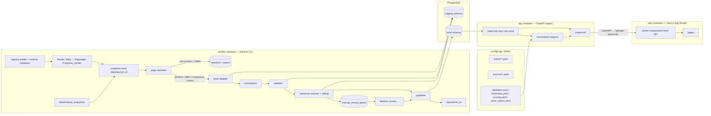
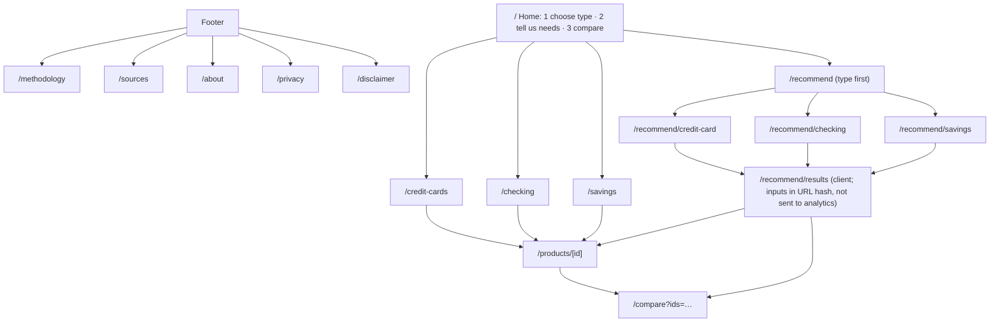

# Phase 3 — Design: Bank Product Recommendation Platform v2

Status: **draft awaiting approval**. No implementation code beyond the Phase 2 import guard has been written.

Contents
1. Architecture
2. Repository layout
3. Database schema (ERD)
4. Data flow and pipeline stages
5. Source registry
6. Retrieval, snapshots, and classification
7. Adapter design
8. Normalization
9. Validation states, verification labels, and publication
10. Deduplication and canonical identity
11. Freshness
12. Recommendation formulas
13. API
14. Frontend page map
15. Privacy and security controls
16. Root-problem → control mapping
17. Testing strategy
18. Migration plan and phase deliverables
19. Deviations from §3 of the brief
20. Blockers and open questions

---

## 1. Architecture



Key properties:

- **Two Postgres schemas.** `staging` holds pipeline state: registry mirror, runs, pages, snapshots, candidates,
  validation, review, and provenance. `prod` holds published, user-facing records only. The API's DB role has
  `SELECT` on `prod` only, so the API cannot read staging, the review queue, or raw snapshots.
- **One CLI (`bankrec`)** runs ingestion, review, publishing, reports, and seeding. It is built on Typer.
- **The recommender is a pure library** (`bankrec.recommend`). It takes product DTOs, a request, and config, and
  returns results. It has no DB access, which makes it deterministic and easy to unit-test.
- **Request-time evaluation** of offer expiry and staleness lives in one function, `bankrec.freshness.evaluate(record, now)`.
  The API, the recommender, and reports all call it.

## 2. Repository layout

```
pyproject.toml, uv.lock          # Python project (uv)
alembic.ini, migrations/         # Alembic
src/bankrec/
  settings.py                    # pydantic-settings, env-driven (dev/prod)
  db/        models_staging.py, models_prod.py, session.py
  registry/  schema.py, loader.py            # YAML → validated models, mirrored to staging.source_registry
  ingest/
    fetch.py, robots.py, ratelimit.py, snapshot.py, outcome.py
    common/  text.py, spans.py, html.py, pdf.py, rules.py  # shared helpers (adapters import only these)
    adapters/ base.py, _template.py, bank_of_america.py, chase.py, capital_one.py,
              us_bank.py, american_express.py, example_bank.py
  classify/  signals.py, classifier.py
  parsers/   money.py, percent.py, period.py, rewards.py, network.py   # pure functions
  normalize/ categories.py, product.py, offer.py
  validation/ rules.py, consistency.py, conflicts.py, status.py
  dedup/     canonical.py, fuzzy.py, offers.py
  review/    service.py                    # used by CLI
  publish/   publisher.py, versions.py
  freshness.py
  reports/   writer.py, builders.py
  recommend/ common.py, cards.py, checking.py, savings.py, explain.py, config.py
  api/       app.py, deps.py, schemas.py, routers/*.py, security.py, logging.py
  cli/       main.py (bankrec), ingest.py, review.py, report.py, db.py
config/
  banks/_template.yaml, bank_of_america.yaml, chase.yaml, capital_one.yaml, us_bank.yaml,
        american_express.yaml, example_bank.yaml
  sources/<bank_id>.yaml
  validation.yaml, freshness.yaml, scoring.yaml, point_values.yaml, reward_categories.yaml
tests/
  unit/…, adapters/test_<bank>.py, fixtures/<bank_id>/…, db/…, api/…, test_legacy_import_guard.py
web/                             # Next.js + TS strict + Tailwind + pnpm, Vitest, Playwright
  src/app/…, src/components/…, src/lib/api/types.gen.ts (generated)
docker/ api.Dockerfile, web.Dockerfile, worker.Dockerfile, worker.crontab
docker-compose.yml, docker-compose.prod.yml, .env.example
.github/workflows/ ci.yml, scheduled-ingest.yml
data/raw/, data/manual_snapshots/, reports/, legacy/, docs/
```

The brief's paths (`ingest/adapters/<bank_id>.py`, `parsers/`, `normalize/`, `validation/`, `dedup/`,
`recommend/`) all live under `src/bankrec/`. Coverage targets apply to those packages.

## 3. Database schema (ERD)

Conventions: `id` is a UUID. Money is a `BIGINT` in cents with a `_cents` suffix. Rates are `NUMERIC(7,4)` with
an explicit unit column or suffix (`_pct` means a percentage, so 4.25 means 4.25%). Every nullable domain field `x`
has a companion `x_null_reason` enum (`not_found | not_applicable | ambiguous | conflict`) **or** is covered by
`field_provenance.null_reason`. I chose the second option, because companion columns would double the column count.
A CHECK-backed view, `staging.v_missing_without_reason`, must be empty before publishing.

### 3.1 staging schema (pipeline)

```mermaid
erDiagram
  banks ||--o{ source_registry : has
  source_registry ||--o{ source_pages : resolves_to
  scrape_runs ||--o{ page_snapshots : produced
  source_pages ||--o{ page_snapshots : versions
  page_snapshots ||--o{ extraction_candidates : yields
  page_snapshots ||--o{ page_mentions : mentions
  extraction_candidates ||--o{ field_provenance : fields
  extraction_candidates ||--o{ validation_results : checked
  extraction_candidates }o--|| staged_products : resolves_to
  staged_products ||--o{ product_aliases : known_as
  staged_products ||--o{ staged_offers : has
  duplicate_candidates }o--|| staged_products : a_or_b
  manual_review_queue }o--|| staged_products : about
  manual_review_queue ||--o{ review_decisions : decided_by

  scrape_runs { uuid id PK; timestamptz started_at; timestamptz finished_at; text trigger; text status; jsonb stage_counts; text git_sha }
  source_registry { text source_id PK; text bank_id FK; text product_type; text source_url; text source_kind; text parser_name; bool requires_render; bool enabled; int priority; text expected_entity; text state; bool test_only; text notes }
  source_pages { uuid id PK; text source_id FK; text requested_url; text final_url; text domain }
  page_snapshots { uuid id PK; uuid run_id FK; uuid source_page_id FK; text capture_method; timestamptz retrieved_at; int http_status; jsonb redirect_chain; text content_type; text sha256; text raw_path; text text_path; text outcome; text page_type; jsonb classifier_signals }
  page_mentions { uuid snapshot_id FK; uuid staged_product_id FK; text mention_text; int span_start; int span_end }
  extraction_candidates { uuid id PK; uuid snapshot_id FK; text entity_kind; text parser_name; text parser_version; jsonb raw_fields; jsonb normalized_fields; numeric confidence; text status; text[] missing_fields; text parser_notes; uuid staged_product_id FK }
  field_provenance { uuid id PK; uuid candidate_id FK; text field_path; jsonb value; text null_reason; uuid snapshot_id FK; int span_start; int span_end; text span_text; text parser_name; text parser_version; timestamptz retrieved_at; numeric confidence }
  validation_results { uuid id PK; uuid candidate_id FK; text rule_id; text severity; text outcome; text message; jsonb details }
  staged_products { uuid id PK; text canonical_key UK; text bank_id; text product_type; text official_name; text status }
  product_aliases { uuid product_id FK; text alias; text source }
  staged_offers { uuid id PK; uuid product_id FK; text offer_key UK; text status; jsonb fields }
  duplicate_candidates { uuid id PK; uuid a_id; uuid b_id; text kind; text reason; numeric similarity; uuid proposed_canonical; text decision; text final_result }
  manual_review_queue { uuid id PK; text item_kind; uuid item_id; text reason_code; jsonb context; text state; timestamptz created_at }
  review_decisions { uuid id PK; uuid queue_id FK; text action; text reviewer; timestamptz decided_at; text note; jsonb payload }
```

### 3.2 prod schema (published, user-facing)

```mermaid
erDiagram
  banks ||--o{ products : offers
  products ||--o| credit_card_details : card
  products ||--o| checking_account_details : checking
  products ||--o| savings_account_details : savings
  products ||--o{ product_reward_rates : earns
  reward_categories ||--o{ product_reward_rates : category
  products ||--o{ product_benefits : includes
  products ||--o{ offers : has
  products ||--o{ product_versions : history
  offers ||--o{ offer_versions : history
  products ||--o{ product_aliases : aka
  products ||--o{ prod_field_provenance : traced_by

  banks { text bank_id PK; text display_name; text[] official_domains; jsonb product_type_availability; bool test_only }
  products { uuid id PK; text canonical_key UK; text bank_id FK; text product_type; text official_name; text product_family; text variant; text official_url; text terms_url; date verified_at; timestamptz terms_retrieved_at; text verification_label; text[] missing_fields; int current_version }
  credit_card_details { uuid product_id PK; text segment "consumer|business"; bool is_co_branded; text co_brand_partner; bool is_student; bool is_secured; text network; bigint annual_fee_cents; int intro_annual_fee_months; bigint intro_annual_fee_cents; numeric purchase_apr_min_pct; numeric purchase_apr_max_pct; numeric intro_purchase_apr_pct; int intro_purchase_apr_months; numeric bt_apr_min_pct; numeric bt_apr_max_pct; numeric intro_bt_apr_pct; int intro_bt_apr_months; text bt_fee_text; numeric bt_fee_pct; bigint bt_fee_min_cents; numeric cash_apr_pct; numeric cash_fee_pct; bigint cash_fee_min_cents; numeric foreign_tx_fee_pct; bigint secured_min_deposit_cents; text reward_currency "cashback|points|miles|none"; text reward_program; numeric base_rate; text credit_profile_guidance; jsonb eligibility_restrictions }
  product_reward_rates { uuid id PK; uuid product_id FK; text category FK; numeric rate; text rate_unit "pct|x"; bigint cap_cents; text cap_period; numeric post_cap_rate; bool is_rotating; bool requires_activation; bool portal_only; text conditions_text }
  product_benefits { uuid id PK; uuid product_id FK; text benefit_type; text name; bool monetizable; bigint annual_value_cents; text frequency; text conditions_text }
  checking_account_details { uuid product_id PK; text account_type; bigint monthly_fee_cents; jsonb fee_waivers; bigint min_opening_deposit_cents; text overdraft_summary; text[] eligible_states; text customer_eligibility; text access_model "branch|online|hybrid" }
  savings_account_details { uuid product_id PK; numeric apy_pct; jsonb apy_tiers; text rate_type_note; bigint min_opening_deposit_cents; bigint min_balance_cents; bigint monthly_fee_cents; jsonb fee_waivers; text withdrawal_restrictions; int max_withdrawals_per_month; text[] eligible_states; text customer_restrictions; date apy_verified_at }
  offers { uuid id PK; uuid product_id FK; text offer_type; bigint reward_amount; text reward_unit "cents|points|miles"; bigint stated_cash_value_cents; text requirement_type; bigint requirement_amount_cents; int required_dd_count; int qualification_window_days; text qualification_window_text; int holding_period_days; date open_by_date; text promo_code; date start_date; date expiration_date; text audience "public|targeted"; jsonb eligibility_restrictions; text offer_url; text terms_url; timestamptz retrieved_at; date verified_at; text status "current|expired|uncertain|targeted" }
  product_versions { uuid id PK; uuid product_id FK; int version; jsonb snapshot; timestamptz valid_from; timestamptz valid_to; uuid run_id; text change_summary }
  offer_versions { uuid id PK; uuid offer_id FK; int version; jsonb snapshot; timestamptz valid_from; timestamptz valid_to; uuid run_id }
  reward_categories { text code PK; text label; text parent }
  prod_field_provenance { uuid product_id FK; uuid offer_id FK; text field_path; uuid snapshot_id; text span_text; text parser_name; text parser_version; timestamptz retrieved_at; text null_reason }
```

Notes:
- `fee_waivers` is a list of structured conditions:
  `{kind: min_daily_balance|min_avg_balance|direct_deposit_total|linked_account|age|student|other, amount_cents?, age_max?, period?, text}`.
  It is validated by a Pydantic model before insert.
- `apy_tiers`: `[{min_balance_cents, max_balance_cents|null, apy_pct}]`, ordered, with no gaps or overlaps (validated).
- `banks.product_type_availability`: `{credit_card: offered|not_offered|unknown, checking: …, savings: …}`,
  each with an evidence URL. This is how "a bank has no public product of this type" gets recorded explicitly.
- The **reward_categories controlled vocabulary**: `groceries, dining, travel, travel_portal, airline, hotel, gas, ev_charging,
  entertainment, streaming, transit, online_shopping, drugstores, wholesale_clubs, home_improvement, rotating, other`
  (`other` is the base rate). Synonym maps live in `config/reward_categories.yaml`.
- Publishing **copies** provenance into `prod_field_provenance`, which lets the API show "source: <url>, verified <date>".
  The full span text is never served publicly. The API exposes only the source URL and dates.
- `product_versions` and `offer_versions` are append-only. Publishing a changed record closes the previous version
  (`valid_to`) and inserts a new one. The current row in `products` and `offers` is a projection of the latest version.

## 4. Data flow and pipeline stages

Every stage is idempotent, keyed by (`run_id`, `source_id`) or the snapshot's `sha256`. Each stage writes counts
and errors to `scrape_runs.stage_counts` and to per-source terminal statuses.

| # | Stage | Input → output | Fails closed by |
|---|---|---|---|
| 1 | Load registry | YAML → `RegistryModel` → `staging.source_registry` | raising on empty, malformed, duplicate (`bank_id`,`source_url`), non-official domain, or unknown parser |
| 2 | Retrieve | URL → bytes. Check robots.txt (cached per host per run), then a per-host token bucket (≥3 s), exponential backoff with jitter on 429/5xx/timeouts (max 3), honest UA `bankrec/<ver> (+<PROJECT_URL>; <CONTACT_EMAIL>)`. Playwright only if `requires_render`; never stealth plugins, proxies, or UA spoofing | robots disallow → `retrieval_failed:robots_disallowed` |
| 3 | Snapshot | bytes → `data/raw/<run_id>/<sha>.{html,pdf,txt}` + `page_snapshots` row | — |
| 4 | Outcome | HTTP status, redirects (cross-domain redirect off the allowlist = fail), block signatures, empty body, login walls | — |
| 5 | Classify | snapshot → `page_type` + fired signals | defaulting to `unknown_page` |
| 6 | Reject | non-product page types → `rejected` with reason | no candidates created |
| 7 | Extract | adapter → `ExtractionCandidate` (raw fields + spans) | a field without a span is dropped |
| 8 | Normalize | raw → typed fields | unparseable → NULL with `ambiguous` |
| 9 | Validate | rules → `valid / needs_review / reject` | see §9 |
| 10 | Resolve | canonical key → `staged_products` | fuzzy match → review |
| 11 | Dedup | products and offers separately | — |
| 12 | Route | `needs_review` → `manual_review_queue` | — |
| 13 | Publish | `valid` (+ approved) → `prod` with versioning | transaction per product |
| 14 | Report | `reports/<run_id>/*` | asserting every registry source has a terminal status |

Terminal per-source statuses: `published`, `unchanged`, `needs_review`, `rejected_page`, `rejected_record`,
`retrieval_failed`, `parser_error`, `disabled`. Before writing reports, a run-level assertion checks that
`{enabled sources} == {sources with a terminal status}`. A gap fails the run with exit code 2.

**Manual capture** (`bankrec ingest --manual <path> --source-url <url> [--captured-at]`) enters at stage 3 with
`capture_method=manual`, so it goes through the same classification, parsing, and validation. The capture date
comes from the CLI argument, or else from the file's mtime, and the report flags which one was used.

## 5. Source registry

`config/banks/<bank_id>.yaml`:
```yaml
bank_id: chase
display_name: Chase
official_domains: [chase.com, creditcards.chase.com, account.chase.com]  # suffix-matched on registrable domain
product_types:
  credit_card: {availability: offered, evidence_url: "<official listing URL>"}
  checking:    {availability: offered, evidence_url: "<…>"}
  savings:     {availability: offered, evidence_url: "<…>"}
adapter: chase
test_only: false
block_signatures: []   # optional bank-specific strings, in addition to the shared list
```
`config/sources/<bank_id>.yaml`: a list of entries with exactly the brief's §6.1 fields, plus `state`
(`curated | discovered | disabled`) and an optional `slug`. Discovery writes `state: discovered, enabled: false`
entries to `config/sources/<bank_id>.discovered.yaml`, which a human must review before promoting them.

**Seed URLs.** I cannot retrieve or confirm any official URL from this session (§20). I will not invent URLs. The
real-bank source files will list only URLs that you supply or that I confirm once network access exists. Until
then, each real bank's source file is **valid but contains zero enabled sources**, and the loader treats that as
an error for that bank ("bank has no enabled sources"). The run report surfaces it rather than silently producing
zero records. `bankrec ingest --allow-empty-bank <id>` exists only for CI smoke runs.

## 6. Retrieval, snapshots, and classification

**Block and outcome signatures** (shared list, plus per-bank extras): HTTP 403/429/503 with challenge markers;
known bot-protection markers ("Access Denied", "Reference #", "Request unsuccessful", "Pardon Our Interruption",
"Please enable JavaScript", `_Incapsula_`, `cf-chl`, `px-captcha`, `akamai`); login markers (password inputs plus a
"sign in" title); empty text (< 400 visible characters after boilerplate removal).

**Classifier.** This is an ordered, explainable rule set, not ML. Each rule emits a signal name. The first decisive
rule wins, and all fired signals are stored.

1. Domain not in the allowlist → `invalid_page`
2. Retrieval outcome blocked / login / empty → `blocked_page` / `login_page` / `empty_page`
3. Content-type PDF → `pdf_terms` (if it contains "Pricing", "Terms", "APR", or "Schumer box" markers) else `unknown_page`
4. URL patterns + structure (from bank config, with shared defaults): `/faq`, "Frequently Asked" headings with ≥5 Q/A pairs → `faq`;
   article markers (byline, "min read", `/learn/`, `/insights/`) → `article`; terms markers → `terms_page`
5. Product evidence: number of distinct product-name candidates that match `expected_entity`, plus the presence of a fee/APR/APY block
   - exactly one product with a fee/APR/APY block → `official_product_detail`
   - offer markers ("bonus", "earn $", "after you spend", "qualifying direct deposit") plus one product → `official_offer_detail`
   - ≥2 products, each with its own fee or rate → `official_comparison_page`
   - ≥2 products without rates, or tile lists → `category_page`
   - product name present but no terms → `official_marketing_page`
6. Otherwise → `unknown_page`

Only `official_product_detail`, `official_offer_detail`, `official_comparison_page`, `terms_page`, and `pdf_terms`
reach adapters. Comparison pages produce candidates capped at `needs_review` confidence (§9).

## 7. Adapter design

```python
class BankAdapter(Protocol):
    bank_id: ClassVar[str]
    parser_version: ClassVar[str]          # e.g. "chase/2026.10.1"; stored on every candidate & provenance row
    def extract(self, page: ClassifiedPage) -> list[ExtractionCandidate]: ...
```
- `ClassifiedPage` carries the snapshot ID, page type, the DOM (selectolax), the visible text with a stable
  offset map, and the source registry entry.
- `ExtractionCandidate` is a Pydantic model whose every field is a `Sourced[T]`:
  `{value: T | None, null_reason, span: (start, end), span_text, confidence}`.
  **A constructor invariant rejects a non-null value without a span whose text is found in the snapshot text.**
  This is the main technical guard against fabricated or guessed values.
- `BaseDeclarativeAdapter` reads optional `config/banks/<bank_id>.rules.yaml` (CSS selectors and regex per field,
  with label anchors such as "Annual Fee", "Purchase APR"). Bank modules override hooks only for complex pages.
- Adapters may import only `bankrec.ingest.common`, `bankrec.parsers`, and `bankrec.normalize`. An AST test enforces
  that no adapter imports another adapter.
- The shared extractors in `ingest/common/` cover the patterns that recur across U.S. issuers: Schumer-box tables
  ("Annual Fee", "APR for Purchases", "Balance Transfer Fee", "Foreign Transaction Fee"), "Earn N% / Nx on <category>"
  reward phrases with caps ("on up to $X in combined purchases each quarter"), and bonus phrases ("Earn $X after you spend
  $Y on purchases in the first N months"). Bank adapters mostly configure these.
- The `_template.py` + `_template.yaml` pair is the copy source for a new bank (§18 of the brief, plus `docs/ADDING_A_BANK.md`).

## 8. Normalization

Pure functions in `bankrec.parsers` (covered by Hypothesis round-trip and robustness tests):
- `parse_money("$1,250")` → 125000 cents. It handles `$0`, `None`, `no annual fee`, `$95 annual fee`, `$0 intro for the first year, then $95`,
  and ranges. It never returns a value for text with no number unless a phrase is in an explicit zero-list ("no annual fee", "$0").
- `parse_percent("20.24% - 29.24% Variable")` → (20.24, 29.24, variable=True). It handles "Prime + x%" by returning NULL
  with `ambiguous` (the margin is kept in notes) rather than computing a guess.
- `parse_period("15 billing cycles" | "first 3 months" | "90 days")` → (value, unit) plus a days estimate. Billing cycles
  are kept as cycles; days are only computed where the unit is days, months (×30, flagged), or years.
- `parse_reward_rate("3% cash back" | "5X points" | "2 miles per $1")` → (rate, unit, currency).
- Category normalization goes through the synonym map. An unmapped phrase gives `other` plus a `needs_review` flag, never a silent drop.
- Network detection uses the explicit network name in the text only.

## 9. Validation states, verification labels, and publication

**Required fields by type** (`config/validation.yaml`):
- card: `official_name`, `segment`, `annual_fee`, `purchase_apr` (or `not_applicable` for charge cards), `foreign_tx_fee`, `reward_currency`, `base_rate` (or `not_applicable`), `official_url`
- checking: `official_name`, `monthly_fee`, `fee_waivers` (may be an explicit empty list), `min_opening_deposit`, `official_url`
- savings: `official_name`, `apy` (or tiers), `monthly_fee`, `min_opening_deposit`, `official_url`
- offer: `offer_type`, `reward_amount` + `unit`, `requirement_type` + `amount`, `qualification_window`, `audience`, `offer_url`

**Rules** (each with a stable `rule_id`, recorded in `validation_results`):
- `R-NAME`: name non-empty, not in the generic deny-list (`unknown`, `credit card`, `apply now`, `checking`, `savings`, `learn more`, …), and found verbatim (case- and ®™-insensitive) in the snapshot text
- `R-DOMAIN`: official domain
- `R-PAGE`: page type is allowed for publishing
- `R-REQ`: required fields present, or explicitly `not_applicable`
- `R-SPAN`: every non-null value has a verified span
- `C-INTRO-APR` (intro < purchase min), `C-WINDOW>0`, `C-APY∈[0,15]`, `C-FEE∈[0, $1,000]` for cards / `[0, $50]`/month for deposit accounts, `C-CAT≥BASE` (unless the source says otherwise), `C-TIERS` (monotonic and non-overlapping), `C-OFFER-DATES` (start ≤ expiry)
- `X-CONFLICT`: two sources disagree on a field after normalization. Both values and sources are stored, and the status is `needs_review`.
- `F-FRESH`: within the freshness window

**Confidence** (internal only) = min over required fields of the field confidence. Field confidence comes from the
source priority (product_detail 1.0, offer_detail 0.95, pdf_terms 0.9, comparison 0.6, manual snapshot ×1.0) × the
extraction method (labelled table cell 1.0, label-anchored regex 0.9, free-text regex 0.75). The threshold is in
`config/validation.yaml` (default 0.85). Comparison-only fields therefore never reach `valid` alone.

**Status** = `reject` if any `R-*` rule fails at error severity; else `needs_review` if there is any conflict, a consistency
failure, confidence below threshold, or a comparison-only source; else `valid`.

**Publication.** `valid` → auto-publish. `needs_review` → only after `bankrec review approve <id> --note` (the reviewer
name comes from `--reviewer` or `$BANKREC_REVIEWER`, required). Every action is written to `review_decisions`.
`review edit` requires `--evidence "<quote>"`, which must be found in a stored snapshot for that product. The span is
then recorded as provenance with `parser_name=manual_review`.

**User-facing label** (computed at request time):
- **Verified**: published, not stale, `missing_fields` limited to the non-critical set → shown everywhere, recommendation-eligible
- **Partially verified**: published, but stale or missing non-critical fields → browse and compare only, with the missing items listed
- **Under review**: never served by the API (it lives in staging only)
- Per-claim: an offer with `status != current` or stale → replaced with "We couldn't verify this — check the bank's site."

## 10. Deduplication and canonical identity

`canonical_key = f"{bank_id}:{product_type}:{segment}:{norm(name)}:{norm(variant) or '-'}"` where `norm` does NFKC,
lowercases, strips ®™℠, collapses punctuation and whitespace, and removes stopwords (`card`, `credit card`, `account`,
`the`, `from <bank>`). Example: "Chase Freedom Unlimited® Credit Card" → `chase:credit_card:consumer:chase freedom unlimited:-`.
The URL is never part of identity.

- Exact key match with both candidates `valid` → auto-merge (the result is an alias plus a page mention).
- Fuzzy matches go to review only. A match is token-set ratio ≥ 0.85 within the same (`bank`, `type`), or a name that is a prefix
  of the other. Pairs that differ in annual fee, segment, or co-brand tier are proposed as **distinct**, with the reason shown.
- Retrieval failures never enter dedup (they have no candidates), which fixes legacy problem #8 at the source.
- Offer key: (`product_id`, `offer_type`, `reward_amount`, `reward_unit`, `requirement_type`, `requirement_amount`, `window_days`, `audience`).
- Reports: `duplicates.csv` / `.md` with the brief's columns.

## 11. Freshness

`config/freshness.yaml`: `offer_days: 14`, `apy_days: 7`, `terms_days: 60`. `freshness.evaluate(record, now)` returns
`fresh | stale | expired` per facet. An offer whose `expiration_date < today (America/New_York)` is `expired` at request time,
whatever its stored status. `bankrec report stale` lists everything past its window. Scheduling: a cron in the worker
image (`0 9 * * 1,4`, twice weekly, so APY stays inside 7 days) and `.github/workflows/scheduled-ingest.yml` as an
alternative, uploading reports as artifacts. The UI says "Last verified <date>" and never says "real-time".

## 12. Recommendation formulas

All weights live in `config/scoring.yaml`, and point values in `config/point_values.yaml`. Eligibility (all types):
label = Verified, not `test_only`, and offers filtered to `status=current ∧ audience=public ∧ fresh ∧ not expired`.

### 12.1 Credit cards
Let `s_c` be the user's monthly spend in category c, and `S = Σ s_c`. Annual spend is `A_c = 12·s_c`. Let `cpp` be cents per point
for the card's program (default 1.0; the issuer's fixed cash-redemption value where published; overridable by the user).

For each reward-rate row r on category c with cap `K` per period `P` (periods per year `n_P`):
```
eligible_c   = A_c  (non-rotating) | 0 unless user opted in (rotating) → min(A_c, K·n_P)
capped_c     = min(eligible_c, K·n_P)  if K else eligible_c
overflow_c   = eligible_c − capped_c
rewards_c    = capped_c·rate + overflow_c·post_cap_rate
base_spend   = 12·S − Σ_c eligible_c    (spend not matched to a bonus category, incl. portal-only categories → base)
annual_rewards_units = Σ_c rewards_c + base_spend·base_rate
annual_rewards_$     = units × (1 for cashback | cpp/100 for points/miles)
```
Portal-only rates are never applied (spend goes to base) and are listed as a non-monetized feature.
- `ongoing = annual_rewards_$ + Σ credits_user_will_use − annual_fee` (credits count only if monetizable and the user ticks them)
- `bonus = reward_value(offer)` if `projected_spend(window) ≥ requirement` else 0, where `projected_spend = S · window_months`
- `first_year = ongoing + bonus + (annual_fee − first_year_fee)` (the waived first-year fee difference)
- Hard filters: segment; `annual_fee > max_fee` when the exclusion toggle is on; secured/student intent (a user wanting
  secured or student cards sees those only, and a user not wanting them doesn't); credit profile only when the issuer publishes guidance.
- When the fee is over the user's max (and not excluded), the card is shown with the note "estimated value exceeds the fee by $X under your inputs", or it is dropped if `ongoing ≤ 0`.

**Score (0–100)** = Σ w_k · n_k, where each component n_k ∈ [0,1]:
| Component | n_k |
|---|---|
| ongoing | min-max over the eligible set (clipped at 0) |
| first_year | min-max, weighted by bonus importance (low 0.25 / medium 1 / high 2 multiplier on its w) |
| category_match | share of the user's spend earning above base |
| goal_match | goal-specific: cashback→currency match; travel→travel benefits + no FTF; low_interest→1 − norm(purchase_apr_min); balance_transfer→norm(intro_bt_months) × (1 − bt_fee/5%); build_credit→secured/student/no-fee |
| foreign_fee_fit | 1 if FTF = 0 or the user doesn't care, else 0 |
| travel_benefit_fit | travel frequency × presence of travel/airline/hotel benefits |
| credit_profile_fit | 1 if no published guidance or it matches; 0.5 if adjacent |
| completeness | 1 − missing_non_critical / total_non_critical |

Default weights: ongoing .30, first_year .15, category_match .15, goal_match .20, foreign_fee .05, travel_benefit .05, credit_profile .05, completeness .05.

### 12.2 Checking
```
window_dd_total   = monthly_dd × window_days/30
achievable        = has_dd ∧ window_dd_total ≥ required_total ∧ dd_count_possible(window) ≥ required_count
                    (requirement_type ≠ direct_deposit → achievable if balance/deposit condition met)
fee_annual        = 0 if any waiver satisfied by inputs else monthly_fee × 12
net_first_year    = (achievable ? bonus : 0) − fee_annual
```
The explanation always carries "Requirement achievable: yes/no, because …" generated from the comparison above.
State eligibility is a hard filter. Score components: net value, achievability margin `(window_dd_total/required − 1)` clipped,
qualification time (shorter is better), holding requirement, min-balance burden, branch preference match.

### 12.3 Savings
```
apy        = tier_apy(deposit)
interest   = deposit × apy/100 × months/12     (simple; noted: APY is variable, assumes constant rate)
bonus_ok   = deposit ≥ new_money_required ∧ holding_months ≥ required_hold
net        = interest + (bonus_ok ? bonus : 0) − unwaived_fee × months
```
The deposit is the midpoint of the user's chosen range. The explanation shows the range and the midpoint used.
Liquidity need high → a penalty for withdrawal limits or a hold period longer than the user's horizon. Score components:
net value, APY vs bonus importance, liquidity fit, fee fit, completeness.

### 12.4 Explanations
`explain.py` builds structured `Reason` objects from score components, such as
`{code:"category_match", params:{categories:["groceries","dining"], share:0.62}}`. The UI renders them from templates,
with no free text. Every result also includes the value split, the fees, the current offer with source and verified date,
limitations (caps, activation, holds, states, the cpp assumption), and the official link. `GET /methodology` serves
`scoring.yaml` and `point_values.yaml` verbatim (as a sanitized model).

## 13. API (`/api/v1`)

The endpoints are as specified in the brief. Implementation notes:
- **Read-only DB role over `prod`**. The routers depend on a `ProductRepository`, and `recommend` is pure on top of it.
- `POST /recommend` takes a discriminated union on `product_type` (`credit_card | checking | savings`), with Pydantic
  constraints on ranges (enums for broad ranges: e.g. `deposit_range: "lt_1k"|"1k_10k"|…`; spend per category ≤ $50k/month).
- Pagination is `page` + `page_size` (max 100). Filters are as listed, and `card_flags` is a CSV of `co_branded,student,secured,business`.
- Errors use one problem+json shape, with no stack traces, parser exceptions, or confidence numbers.
- Middleware: request ID, JSON access log (method, path, status, latency, no bodies, no query string for POSTs), body-size
  limit (16 KB), a per-IP token bucket on POST, CORS to `WEB_ORIGIN` only, security headers, `/health` (liveness) and `/ready` (DB ping + migration head check).

## 14. Frontend page map


- Listings and detail pages are server components (SSR, `revalidate` 1h) with `generateMetadata`.
- The quiz and results pages are client components. Recommendation inputs stay in component state and the URL **fragment**
  (`#…`, never sent to servers or logs), and are posted only to `/api/v1/recommend`.
- Components: `ProductCard`, `VerificationBadge` (Verified / Partially verified), `OfferBlock` (with "Expired offer" / "Offer not
  recently verified" / "We couldn't verify this" states), `ValueSplit`, `ScoreBreakdown`, `CppAdjuster`, `FilterBar`,
  `CompareTable`, `Skeleton*`, `EmptyState`, `ErrorState`, `Disclaimer`, `SourceLink` (`target=_blank rel="noopener noreferrer"`).
- Visual tokens in Tailwind: navy `#0B1F3A` for the brand, slate text `#334155`, emerald `#047857` for positive values,
  white/`#F8FAFC` backgrounds, Inter via `next/font`, `motion-reduce:` variants. Bank names are plain text with no logos.
- Empty production data is a first-class state: "No verified products yet for <bank/type>. See Data Sources for status."

## 15. Privacy and security controls
- No model or table has fields for account numbers, credentials, SSN, exact balances, DOB, or transactions. The recommend
  request schemas accept only enums and broad numbers, with `extra="forbid"`.
- Tests assert that a recommend call (a) writes nothing to the DB (row counts before and after, plus a statement-capturing
  event listener confirms no INSERT/UPDATE) and (b) leaves no request-body content in captured logs (sentinel values).
- No analytics. CSP `default-src 'self'`. Error tracking hook (`SENTRY_DSN`) is off by default and configured with `send_default_pii=False`
  and request bodies stripped.
- Containers run as non-root. `pip-audit` and `pnpm audit` run in CI. Secrets only come from the env (`.env.example` documents them).

## 16. Root-problem → control mapping

| # | Legacy root problem | v2 control |
|---|---|---|
| 1 | Empty/malformed sources → silent zero | Registry schema validation; empty registry or bank with no enabled sources raises; run-level terminal-status assertion |
| 2 | Landing pages as sources | `source_kind` + `expected_entity`; classifier sends listing/category pages to `category_page` (discovery only) |
| 3 | JS/bot/PDF/redirect failures | Outcome detection, `requires_render`, pdfplumber, redirect allowlist, manual-capture route |
| 4 | Non-product pages parsed as products | Classifier hard rules; only product page types reach adapters |
| 5 | `unknown`/wrong names | `R-NAME` (deny-list + must appear in page text) |
| 6 | Missing/wrong fields | Span-verified `Sourced[T]`; normalizers with explicit null reasons; consistency rules |
| 7 | Partial records discarded or shown as complete | `missing_fields` + "Partially verified" label listing what's missing |
| 8 | Failed pages counted as duplicates | Failures never produce candidates; dedup runs after stage 6 |
| 9 | URL-based dedup | Canonical key without URL; aliases and page mentions separate |
| 10 | Unnormalized rewards | Controlled vocabulary + rate parser + units |
| 11 | Products vs offers conflated | Separate `offers` entity and versioning |
| 12 | Expired offers kept as current | Request-time `freshness.evaluate` |
| 13 | Low-confidence records in recs | Recommender eligibility = Verified only; enforced in the engine and tested |
| 14 | Untrustworthy UI | Design tokens, verification badges, source links + dates, no logos, a11y tests |
| 15 | Opaque scoring | Config-driven weights, `/methodology`, per-component breakdown |

## 17. Testing strategy
- **Unit:** parsers (example-based + Hypothesis), normalizers, classifier (one fixture per page type), validation rules,
  canonical key, fuzzy routing, freshness (frozen clock), recommender (hand-computed expected values for every formula
  branch: caps, overflow, rotating opt-in, bonus achievable or not, first-year vs ongoing, checking achievability, savings holds).
- **Adapters:** `tests/adapters/test_<bank>.py`. Real-bank tests use verbatim official fixtures with a `RETRIEVED.txt`
  (URL, date, method). **Until those exist, they are `pytest.mark.skip(reason="pending: no verbatim official fixture — bank domains blocked by egress policy in build env; see docs/AUDIT.md §9")`**.
  Each real adapter's logic is still exercised against synthetic Example Bank pages that use the same shared extractors.
- **DB:** real PostgreSQL via `DATABASE_URL` (the local cluster here, the compose service in CI). Alembic upgrade/downgrade
  is tested. `testcontainers` is used automatically when `DATABASE_URL` is unset and Docker is available.
- **API:** httpx `AsyncClient` against the app with a seeded test DB (Example Bank records published through the real pipeline, `test_only` honored by an env flag in tests only).
- **Privacy, legacy guard, adapter isolation, registry-terminal-status** tests.
- **Frontend:** Vitest + RTL for components. Playwright E2E for home → quiz → results → detail → compare for each type, filters,
  empty and error states, and axe on every major page. Screenshots at 375 / 768 / 1280.
- **E2E data problem:** with no verified real data, E2E needs records. E2E runs against an API seeded with **Example Bank** data
  (fictional, labeled "Example Bank (test data)") in a `E2E_TEST_DATA=1` mode that production builds refuse to enable.
  Screenshots in `docs/screenshots/` will be captured in that mode and captioned as such. They will never show real-bank data I haven't verified.

## 18. Migration plan and phase deliverables
There is no legacy data to migrate (AUDIT.md). The "migration" is: Alembic `0001_initial` creates the `staging` + `prod`
schemas, then the `reward_categories` seed. Later schema changes are additive Alembic revisions. Seeding: `bankrec db seed`
copies **only** published prod records from a prior export (`bankrec db export-prod` → JSONL) and refuses `test_only` banks unless `--include-test`.
Backup and restore: `pg_dump -Fc` of the `prod` and `staging` schemas plus a tarball of `data/raw` (snapshots back the provenance), documented in README.

Phase 4 → 8 commits, one or more per phase, in priority order: pipeline correctness → validation → recommender → API → frontend → polish.

## 19. Deviations from §3 of the brief

| Item | Deviation | Reason |
|---|---|---|
| Python | 3.13 in this environment; `requires-python >=3.12` | Meets "3.12+" |
| HTML parsing | selectolax (primary), BeautifulSoup+lxml only as a fallback for malformed markup | Speed and stable text offsets |
| DB tests | Real Postgres via `DATABASE_URL` first; testcontainers optional | No Docker daemon in this build environment, so testcontainers cannot run here. Still real Postgres, no SQLite |
| Branch name | Work is pushed to `claude/blissful-feynman-qua5w1` rather than `v2-rebuild` | This session's git policy pins the push branch. I can also push `v2-rebuild` if you confirm (see §20) |
| Docker / compose | Written in full, but verifiable only in CI or on your machine | No Docker daemon here |
| CLI | Typer | Not specified in the brief; small and type-hint-driven |

## 20. Blockers and open questions

1. **No network access to any bank domain** from this session (HTTP 403 from the egress proxy for all five banks; AUDIT §9).
   Consequences if not resolved: no real ingestion, no verbatim fixtures, an empty production dataset, real-bank adapter tests
   pending, and `docs/TRACE.md` limited to an Example Bank trace. Remedies: (a) add the five banks' domains to this environment's
   allowed domains (environment settings → Network access), (b) run `bankrec ingest` yourself, or (c) save pages into `data/manual_snapshots/`.
   I will not substitute any data in the meantime.
2. **Legacy files are absent.** If they exist elsewhere, add them under `legacy/` (untrusted, hints only).
3. **Branch:** keep pushing to `claude/blissful-feynman-qua5w1`, or also create and push `v2-rebuild`?
4. **Contact address for the User-Agent:** it is read from `BANKREC_CONTACT_EMAIL`. I won't hard-code your email; please confirm what to put in `.env.example` (a placeholder by default).
