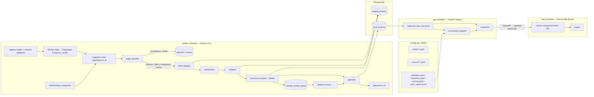
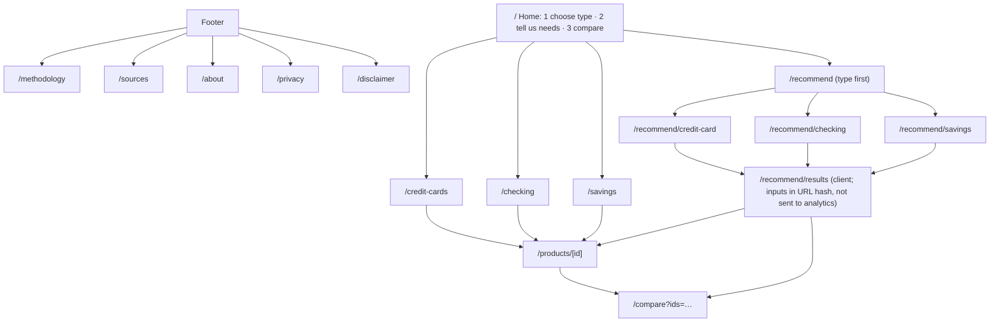

# Phase 3 — Design: Bank Product Recommendation Platform v2

Status: **draft awaiting approval**. No implementation code beyond the Phase 2 import guard has been written.

Contents
1. Architecture
2. Repository layout
3. Database schema (ERD)
4. Data flow and pipeline stages
5. Source registry
6. Retrieval, snapshots, and classification
7. Adapter design
8. Normalization
9. Validation states, verification labels, and publication
10. Deduplication and canonical identity
11. Freshness
12. Recommendation formulas
13. API
14. Frontend page map
15. Privacy and security controls
16. Root-problem → control mapping
17. Testing strategy
18. Migration plan and phase deliverables
19. Deviations from §3 of the brief
20. Blockers and open questions
21. Amendment 1 — Freshness, change detection, and multi-source layer
22. Amendment 2 — Anonymous public-offer capture and offer amount qualifiers

---

## 1. Architecture



Key properties:

- **Two Postgres schemas.** `staging` holds pipeline state: registry mirror, runs, pages, snapshots, candidates,
  validation, review, and provenance. `prod` holds published, user-facing records only. The API's DB role has
  `SELECT` on `prod` only, so the API cannot read staging, the review queue, or raw snapshots.
- **One CLI (`bankrec`)** runs ingestion, review, publishing, reports, and seeding. It is built on Typer.
- **The recommender is a pure library** (`bankrec.recommend`). It takes product DTOs, a request, and config, and
  returns results. It has no DB access, which makes it deterministic and easy to unit-test.
- **Request-time evaluation** of offer expiry and staleness lives in one function, `bankrec.freshness.evaluate(record, now)`.
  The API, the recommender, and reports all call it.

## 2. Repository layout

```
pyproject.toml, uv.lock          # Python project (uv)
alembic.ini, migrations/         # Alembic
src/bankrec/
  settings.py                    # pydantic-settings, env-driven (dev/prod)
  db/        models_staging.py, models_prod.py, session.py
  registry/  schema.py, loader.py            # YAML → validated models, mirrored to staging.source_registry
  ingest/
    fetch.py, robots.py, ratelimit.py, snapshot.py, outcome.py
    common/  text.py, spans.py, html.py, pdf.py, rules.py  # shared helpers (adapters import only these)
    adapters/ base.py, _template.py, bank_of_america.py, chase.py, capital_one.py,
              us_bank.py, american_express.py, example_bank.py
  classify/  signals.py, classifier.py
  parsers/   money.py, percent.py, period.py, rewards.py, network.py   # pure functions
  normalize/ categories.py, product.py, offer.py
  validation/ rules.py, consistency.py, conflicts.py, status.py
  dedup/     canonical.py, fuzzy.py, offers.py
  review/    service.py                    # used by CLI
  publish/   publisher.py, versions.py
  freshness.py
  reports/   writer.py, builders.py
  recommend/ common.py, cards.py, checking.py, savings.py, explain.py, config.py
  api/       app.py, deps.py, schemas.py, routers/*.py, security.py, logging.py
  cli/       main.py (bankrec), ingest.py, review.py, report.py, db.py
config/
  banks/_template.yaml, bank_of_america.yaml, chase.yaml, capital_one.yaml, us_bank.yaml,
        american_express.yaml, example_bank.yaml
  sources/<bank_id>.yaml
  validation.yaml, freshness.yaml, scoring.yaml, point_values.yaml, reward_categories.yaml
tests/
  unit/…, adapters/test_<bank>.py, fixtures/<bank_id>/…, db/…, api/…, test_legacy_import_guard.py
web/                             # Next.js + TS strict + Tailwind + pnpm, Vitest, Playwright
  src/app/…, src/components/…, src/lib/api/types.gen.ts (generated)
docker/ api.Dockerfile, web.Dockerfile, worker.Dockerfile, worker.crontab
docker-compose.yml, docker-compose.prod.yml, .env.example
.github/workflows/ ci.yml, scheduled-ingest.yml
data/raw/, data/manual_snapshots/, reports/, legacy/, docs/
```

The brief's paths (`ingest/adapters/<bank_id>.py`, `parsers/`, `normalize/`, `validation/`, `dedup/`,
`recommend/`) all live under `src/bankrec/`. Coverage targets apply to those packages.

## 3. Database schema (ERD)

Conventions: `id` is a UUID. Money is a `BIGINT` in cents with a `_cents` suffix. Rates are `NUMERIC(7,4)` with
an explicit unit column or suffix (`_pct` means a percentage, so 4.25 means 4.25%). Every nullable domain field `x`
has a companion `x_null_reason` enum (`not_found | not_applicable | ambiguous | conflict`) **or** is covered by
`field_provenance.null_reason`. I chose the second option, because companion columns would double the column count.
A CHECK-backed view, `staging.v_missing_without_reason`, must be empty before publishing.

### 3.1 staging schema (pipeline)

```mermaid
erDiagram
  banks ||--o{ source_registry : has
  source_registry ||--o{ source_pages : resolves_to
  scrape_runs ||--o{ page_snapshots : produced
  source_pages ||--o{ page_snapshots : versions
  page_snapshots ||--o{ extraction_candidates : yields
  page_snapshots ||--o{ page_mentions : mentions
  extraction_candidates ||--o{ field_provenance : fields
  extraction_candidates ||--o{ validation_results : checked
  extraction_candidates }o--|| staged_products : resolves_to
  staged_products ||--o{ product_aliases : known_as
  staged_products ||--o{ staged_offers : has
  duplicate_candidates }o--|| staged_products : a_or_b
  manual_review_queue }o--|| staged_products : about
  manual_review_queue ||--o{ review_decisions : decided_by

  scrape_runs { uuid id PK; timestamptz started_at; timestamptz finished_at; text trigger; text status; jsonb stage_counts; text git_sha }
  source_registry { text source_id PK; text bank_id FK; text product_type; text source_url; text source_kind; text parser_name; bool requires_render; bool enabled; int priority; text expected_entity; text state; bool test_only; text notes }
  source_pages { uuid id PK; text source_id FK; text requested_url; text final_url; text domain }
  page_snapshots { uuid id PK; uuid run_id FK; uuid source_page_id FK; text capture_method; timestamptz retrieved_at; int http_status; jsonb redirect_chain; text content_type; text sha256; text raw_path; text text_path; text outcome; text page_type; jsonb classifier_signals }
  page_mentions { uuid snapshot_id FK; uuid staged_product_id FK; text mention_text; int span_start; int span_end }
  extraction_candidates { uuid id PK; uuid snapshot_id FK; text entity_kind; text parser_name; text parser_version; jsonb raw_fields; jsonb normalized_fields; numeric confidence; text status; text[] missing_fields; text parser_notes; uuid staged_product_id FK }
  field_provenance { uuid id PK; uuid candidate_id FK; text field_path; jsonb value; text null_reason; uuid snapshot_id FK; int span_start; int span_end; text span_text; text parser_name; text parser_version; timestamptz retrieved_at; numeric confidence }
  validation_results { uuid id PK; uuid candidate_id FK; text rule_id; text severity; text outcome; text message; jsonb details }
  staged_products { uuid id PK; text canonical_key UK; text bank_id; text product_type; text official_name; text status }
  product_aliases { uuid product_id FK; text alias; text source }
  staged_offers { uuid id PK; uuid product_id FK; text offer_key UK; text status; jsonb fields }
  duplicate_candidates { uuid id PK; uuid a_id; uuid b_id; text kind; text reason; numeric similarity; uuid proposed_canonical; text decision; text final_result }
  manual_review_queue { uuid id PK; text item_kind; uuid item_id; text reason_code; jsonb context; text state; timestamptz created_at }
  review_decisions { uuid id PK; uuid queue_id FK; text action; text reviewer; timestamptz decided_at; text note; jsonb payload }
```

### 3.2 prod schema (published, user-facing)

```mermaid
erDiagram
  banks ||--o{ products : offers
  products ||--o| credit_card_details : card
  products ||--o| checking_account_details : checking
  products ||--o| savings_account_details : savings
  products ||--o{ product_reward_rates : earns
  reward_categories ||--o{ product_reward_rates : category
  products ||--o{ product_benefits : includes
  products ||--o{ offers : has
  products ||--o{ product_versions : history
  offers ||--o{ offer_versions : history
  products ||--o{ product_aliases : aka
  products ||--o{ prod_field_provenance : traced_by

  banks { text bank_id PK; text display_name; text[] official_domains; jsonb product_type_availability; bool test_only }
  products { uuid id PK; text canonical_key UK; text bank_id FK; text product_type; text official_name; text product_family; text variant; text official_url; text terms_url; date verified_at; timestamptz terms_retrieved_at; text verification_label; text[] missing_fields; int current_version }
  credit_card_details { uuid product_id PK; text segment "consumer|business"; bool is_co_branded; text co_brand_partner; bool is_student; bool is_secured; text network; bigint annual_fee_cents; int intro_annual_fee_months; bigint intro_annual_fee_cents; numeric purchase_apr_min_pct; numeric purchase_apr_max_pct; numeric intro_purchase_apr_pct; int intro_purchase_apr_months; numeric bt_apr_min_pct; numeric bt_apr_max_pct; numeric intro_bt_apr_pct; int intro_bt_apr_months; text bt_fee_text; numeric bt_fee_pct; bigint bt_fee_min_cents; numeric cash_apr_pct; numeric cash_fee_pct; bigint cash_fee_min_cents; numeric foreign_tx_fee_pct; bigint secured_min_deposit_cents; text reward_currency "cashback|points|miles|none"; text reward_program; numeric base_rate; text credit_profile_guidance; jsonb eligibility_restrictions }
  product_reward_rates { uuid id PK; uuid product_id FK; text category FK; numeric rate; text rate_unit "pct|x"; bigint cap_cents; text cap_period; numeric post_cap_rate; bool is_rotating; bool requires_activation; bool portal_only; text conditions_text }
  product_benefits { uuid id PK; uuid product_id FK; text benefit_type; text name; bool monetizable; bigint annual_value_cents; text frequency; text conditions_text }
  checking_account_details { uuid product_id PK; text account_type; bigint monthly_fee_cents; jsonb fee_waivers; bigint min_opening_deposit_cents; text overdraft_summary; text[] eligible_states; text customer_eligibility; text access_model "branch|online|hybrid" }
  savings_account_details { uuid product_id PK; numeric apy_pct; jsonb apy_tiers; text rate_type_note; bigint min_opening_deposit_cents; bigint min_balance_cents; bigint monthly_fee_cents; jsonb fee_waivers; text withdrawal_restrictions; int max_withdrawals_per_month; text[] eligible_states; text customer_restrictions; date apy_verified_at }
  offers { uuid id PK; uuid product_id FK; text offer_type; bigint reward_amount; text reward_unit "cents|points|miles"; bigint stated_cash_value_cents; text requirement_type; bigint requirement_amount_cents; int required_dd_count; int qualification_window_days; text qualification_window_text; int holding_period_days; date open_by_date; text promo_code; date start_date; date expiration_date; text audience "public|targeted"; jsonb eligibility_restrictions; text offer_url; text terms_url; timestamptz retrieved_at; date verified_at; text status "current|expired|uncertain|targeted" }
  product_versions { uuid id PK; uuid product_id FK; int version; jsonb snapshot; timestamptz valid_from; timestamptz valid_to; uuid run_id; text change_summary }
  offer_versions { uuid id PK; uuid offer_id FK; int version; jsonb snapshot; timestamptz valid_from; timestamptz valid_to; uuid run_id }
  reward_categories { text code PK; text label; text parent }
  prod_field_provenance { uuid product_id FK; uuid offer_id FK; text field_path; uuid snapshot_id; text span_text; text parser_name; text parser_version; timestamptz retrieved_at; text null_reason }
```

Notes:
- `fee_waivers` is a list of structured conditions:
  `{kind: min_daily_balance|min_avg_balance|direct_deposit_total|linked_account|age|student|other, amount_cents?, age_max?, period?, text}`.
  It is validated by a Pydantic model before insert.
- `apy_tiers`: `[{min_balance_cents, max_balance_cents|null, apy_pct}]`, ordered, with no gaps or overlaps (validated).
- `banks.product_type_availability`: `{credit_card: offered|not_offered|unknown, checking: …, savings: …}`,
  each with an evidence URL. This is how "a bank has no public product of this type" gets recorded explicitly.
- The **reward_categories controlled vocabulary**: `groceries, dining, travel, travel_portal, airline, hotel, gas, ev_charging,
  entertainment, streaming, transit, online_shopping, drugstores, wholesale_clubs, home_improvement, rotating, other`
  (`other` is the base rate). Synonym maps live in `config/reward_categories.yaml`.
- Publishing **copies** provenance into `prod_field_provenance`, which lets the API show "source: <url>, verified <date>".
  The full span text is never served publicly. The API exposes only the source URL and dates.
- `product_versions` and `offer_versions` are append-only. Publishing a changed record closes the previous version
  (`valid_to`) and inserts a new one. The current row in `products` and `offers` is a projection of the latest version.

## 4. Data flow and pipeline stages

Every stage is idempotent, keyed by (`run_id`, `source_id`) or the snapshot's `sha256`. Each stage writes counts
and errors to `scrape_runs.stage_counts` and to per-source terminal statuses.

| # | Stage | Input → output | Fails closed by |
|---|---|---|---|
| 1 | Load registry | YAML → `RegistryModel` → `staging.source_registry` | raising on empty, malformed, duplicate (`bank_id`,`source_url`), non-official domain, or unknown parser |
| 2 | Retrieve | URL → bytes. Check robots.txt (cached per host per run), then a per-host token bucket (≥3 s), exponential backoff with jitter on 429/5xx/timeouts (max 3), honest UA `bankrec/<ver> (+<PROJECT_URL>; <CONTACT_EMAIL>)`. Playwright only if `requires_render`; never stealth plugins, proxies, or UA spoofing | robots disallow → `retrieval_failed:robots_disallowed` |
| 3 | Snapshot | bytes → `data/raw/<run_id>/<sha>.{html,pdf,txt}` + `page_snapshots` row | — |
| 4 | Outcome | HTTP status, redirects (cross-domain redirect off the allowlist = fail), block signatures, empty body, login walls | — |
| 5 | Classify | snapshot → `page_type` + fired signals | defaulting to `unknown_page` |
| 6 | Reject | non-product page types → `rejected` with reason | no candidates created |
| 7 | Extract | adapter → `ExtractionCandidate` (raw fields + spans) | a field without a span is dropped |
| 8 | Normalize | raw → typed fields | unparseable → NULL with `ambiguous` |
| 9 | Validate | rules → `valid / needs_review / reject` | see §9 |
| 10 | Resolve | canonical key → `staged_products` | fuzzy match → review |
| 11 | Dedup | products and offers separately | — |
| 12 | Route | `needs_review` → `manual_review_queue` | — |
| 13 | Publish | `valid` (+ approved) → `prod` with versioning | transaction per product |
| 14 | Report | `reports/<run_id>/*` | asserting every registry source has a terminal status |

Terminal per-source statuses: `published`, `unchanged`, `needs_review`, `rejected_page`, `rejected_record`,
`retrieval_failed`, `parser_error`, `disabled`. Before writing reports, a run-level assertion checks that
`{enabled sources} == {sources with a terminal status}`. A gap fails the run with exit code 2.

**Manual capture** (`bankrec ingest --manual <path> --source-url <url> [--captured-at]`) enters at stage 3 with
`capture_method=manual`, so it goes through the same classification, parsing, and validation. The capture date
comes from the CLI argument, or else from the file's mtime, and the report flags which one was used.

## 5. Source registry

`config/banks/<bank_id>.yaml`:
```yaml
bank_id: chase
display_name: Chase
official_domains: [chase.com, creditcards.chase.com, account.chase.com]  # suffix-matched on registrable domain
product_types:
  credit_card: {availability: offered, evidence_url: "<official listing URL>"}
  checking:    {availability: offered, evidence_url: "<…>"}
  savings:     {availability: offered, evidence_url: "<…>"}
adapter: chase
test_only: false
block_signatures: []   # optional bank-specific strings, in addition to the shared list
```
`config/sources/<bank_id>.yaml`: a list of entries with exactly the brief's §6.1 fields, plus `state`
(`curated | discovered | disabled`) and an optional `slug`. Discovery writes `state: discovered, enabled: false`
entries to `config/sources/<bank_id>.discovered.yaml`, which a human must review before promoting them.

**Seed URLs.** I cannot retrieve or confirm any official URL from this session (§20). I will not invent URLs. The
real-bank source files will list only URLs that you supply or that I confirm once network access exists. Until
then, each real bank's source file is **valid but contains zero enabled sources**, and the loader treats that as
an error for that bank ("bank has no enabled sources"). The run report surfaces it rather than silently producing
zero records. `bankrec ingest --allow-empty-bank <id>` exists only for CI smoke runs.

## 6. Retrieval, snapshots, and classification

**Block and outcome signatures** (shared list, plus per-bank extras): HTTP 403/429/503 with challenge markers;
known bot-protection markers ("Access Denied", "Reference #", "Request unsuccessful", "Pardon Our Interruption",
"Please enable JavaScript", `_Incapsula_`, `cf-chl`, `px-captcha`, `akamai`); login markers (password inputs plus a
"sign in" title); empty text (< 400 visible characters after boilerplate removal).

**Classifier.** This is an ordered, explainable rule set, not ML. Each rule emits a signal name. The first decisive
rule wins, and all fired signals are stored.

1. Domain not in the allowlist → `invalid_page`
2. Retrieval outcome blocked / login / empty → `blocked_page` / `login_page` / `empty_page`
3. Content-type PDF → `pdf_terms` (if it contains "Pricing", "Terms", "APR", or "Schumer box" markers) else `unknown_page`
4. URL patterns + structure (from bank config, with shared defaults): `/faq`, "Frequently Asked" headings with ≥5 Q/A pairs → `faq`;
   article markers (byline, "min read", `/learn/`, `/insights/`) → `article`; terms markers → `terms_page`
5. Product evidence: number of distinct product-name candidates that match `expected_entity`, plus the presence of a fee/APR/APY block
   - exactly one product with a fee/APR/APY block → `official_product_detail`
   - offer markers ("bonus", "earn $", "after you spend", "qualifying direct deposit") plus one product → `official_offer_detail`
   - ≥2 products, each with its own fee or rate → `official_comparison_page`
   - ≥2 products without rates, or tile lists → `category_page`
   - product name present but no terms → `official_marketing_page`
6. Otherwise → `unknown_page`

Only `official_product_detail`, `official_offer_detail`, `official_comparison_page`, `terms_page`, and `pdf_terms`
reach adapters. Comparison pages produce candidates capped at `needs_review` confidence (§9).

## 7. Adapter design

```python
class BankAdapter(Protocol):
    bank_id: ClassVar[str]
    parser_version: ClassVar[str]          # e.g. "chase/2026.10.1"; stored on every candidate & provenance row
    def extract(self, page: ClassifiedPage) -> list[ExtractionCandidate]: ...
```
- `ClassifiedPage` carries the snapshot ID, page type, the DOM (selectolax), the visible text with a stable
  offset map, and the source registry entry.
- `ExtractionCandidate` is a Pydantic model whose every field is a `Sourced[T]`:
  `{value: T | None, null_reason, span: (start, end), span_text, confidence}`.
  **A constructor invariant rejects a non-null value without a span whose text is found in the snapshot text.**
  This is the main technical guard against fabricated or guessed values.
- `BaseDeclarativeAdapter` reads optional `config/banks/<bank_id>.rules.yaml` (CSS selectors and regex per field,
  with label anchors such as "Annual Fee", "Purchase APR"). Bank modules override hooks only for complex pages.
- Adapters may import only `bankrec.ingest.common`, `bankrec.parsers`, and `bankrec.normalize`. An AST test enforces
  that no adapter imports another adapter.
- The shared extractors in `ingest/common/` cover the patterns that recur across U.S. issuers: Schumer-box tables
  ("Annual Fee", "APR for Purchases", "Balance Transfer Fee", "Foreign Transaction Fee"), "Earn N% / Nx on <category>"
  reward phrases with caps ("on up to $X in combined purchases each quarter"), and bonus phrases ("Earn $X after you spend
  $Y on purchases in the first N months"). Bank adapters mostly configure these.
- The `_template.py` + `_template.yaml` pair is the copy source for a new bank (§18 of the brief, plus `docs/ADDING_A_BANK.md`).

## 8. Normalization

Pure functions in `bankrec.parsers` (covered by Hypothesis round-trip and robustness tests):
- `parse_money("$1,250")` → 125000 cents. It handles `$0`, `None`, `no annual fee`, `$95 annual fee`, `$0 intro for the first year, then $95`,
  and ranges. It never returns a value for text with no number unless a phrase is in an explicit zero-list ("no annual fee", "$0").
- `parse_percent("20.24% - 29.24% Variable")` → (20.24, 29.24, variable=True). It handles "Prime + x%" by returning NULL
  with `ambiguous` (the margin is kept in notes) rather than computing a guess.
- `parse_period("15 billing cycles" | "first 3 months" | "90 days")` → (value, unit) plus a days estimate. Billing cycles
  are kept as cycles; days are only computed where the unit is days, months (×30, flagged), or years.
- `parse_reward_rate("3% cash back" | "5X points" | "2 miles per $1")` → (rate, unit, currency).
- Category normalization goes through the synonym map. An unmapped phrase gives `other` plus a `needs_review` flag, never a silent drop.
- Network detection uses the explicit network name in the text only.

## 9. Validation states, verification labels, and publication

**Required fields by type** (`config/validation.yaml`):
- card: `official_name`, `segment`, `annual_fee`, `purchase_apr` (or `not_applicable` for charge cards), `foreign_tx_fee`, `reward_currency`, `base_rate` (or `not_applicable`), `official_url`
- checking: `official_name`, `monthly_fee`, `fee_waivers` (may be an explicit empty list), `min_opening_deposit`, `official_url`
- savings: `official_name`, `apy` (or tiers), `monthly_fee`, `min_opening_deposit`, `official_url`
- offer: `offer_type`, `reward_amount` + `unit`, `requirement_type` + `amount`, `qualification_window`, `audience`, `offer_url`

**Rules** (each with a stable `rule_id`, recorded in `validation_results`):
- `R-NAME`: name non-empty, not in the generic deny-list (`unknown`, `credit card`, `apply now`, `checking`, `savings`, `learn more`, …), and found verbatim (case- and ®™-insensitive) in the snapshot text
- `R-DOMAIN`: official domain
- `R-PAGE`: page type is allowed for publishing
- `R-REQ`: required fields present, or explicitly `not_applicable`
- `R-SPAN`: every non-null value has a verified span
- `C-INTRO-APR` (intro < purchase min), `C-WINDOW>0`, `C-APY∈[0,15]`, `C-FEE∈[0, $1,000]` for cards / `[0, $50]`/month for deposit accounts, `C-CAT≥BASE` (unless the source says otherwise), `C-TIERS` (monotonic and non-overlapping), `C-OFFER-DATES` (start ≤ expiry)
- `X-CONFLICT`: two sources disagree on a field after normalization. Both values and sources are stored, and the status is `needs_review`.
- `F-FRESH`: within the freshness window

**Confidence** (internal only) = min over required fields of the field confidence. Field confidence comes from the
source priority (product_detail 1.0, offer_detail 0.95, pdf_terms 0.9, comparison 0.6, manual snapshot ×1.0) × the
extraction method (labelled table cell 1.0, label-anchored regex 0.9, free-text regex 0.75). The threshold is in
`config/validation.yaml` (default 0.85). Comparison-only fields therefore never reach `valid` alone.

**Status** = `reject` if any `R-*` rule fails at error severity; else `needs_review` if there is any conflict, a consistency
failure, confidence below threshold, or a comparison-only source; else `valid`.

**Publication.** `valid` → auto-publish. `needs_review` → only after `bankrec review approve <id> --note` (the reviewer
name comes from `--reviewer` or `$BANKREC_REVIEWER`, required). Every action is written to `review_decisions`.
`review edit` requires `--evidence "<quote>"`, which must be found in a stored snapshot for that product. The span is
then recorded as provenance with `parser_name=manual_review`.

**User-facing label** (computed at request time):
- **Verified**: published, not stale, `missing_fields` limited to the non-critical set → shown everywhere, recommendation-eligible
- **Partially verified**: published, but stale or missing non-critical fields → browse and compare only, with the missing items listed
- **Under review**: never served by the API (it lives in staging only)
- Per-claim: an offer with `status != current` or stale → replaced with "We couldn't verify this — check the bank's site."

## 10. Deduplication and canonical identity

`canonical_key = f"{bank_id}:{product_type}:{segment}:{norm(name)}:{norm(variant) or '-'}"` where `norm` does NFKC,
lowercases, strips ®™℠, collapses punctuation and whitespace, and removes stopwords (`card`, `credit card`, `account`,
`the`, `from <bank>`). Example: "Chase Freedom Unlimited® Credit Card" → `chase:credit_card:consumer:chase freedom unlimited:-`.
The URL is never part of identity.

- Exact key match with both candidates `valid` → auto-merge (the result is an alias plus a page mention).
- Fuzzy matches go to review only. A match is token-set ratio ≥ 0.85 within the same (`bank`, `type`), or a name that is a prefix
  of the other. Pairs that differ in annual fee, segment, or co-brand tier are proposed as **distinct**, with the reason shown.
- Retrieval failures never enter dedup (they have no candidates), which fixes legacy problem #8 at the source.
- Offer key: (`product_id`, `offer_type`, `reward_amount`, `reward_unit`, `requirement_type`, `requirement_amount`, `window_days`, `audience`).
- Reports: `duplicates.csv` / `.md` with the brief's columns.

## 11. Freshness

Superseded in detail by **§21 (Amendment 1)**. Two separate settings live in `config/freshness.yaml`:

- **Check cadence** (`schedule`): how often a source is re-fetched. APY sources every 12 h, offer sources every 24 h,
  product terms weekly, CFPB datasets on new release.
- **Staleness window** (`stale_after`): how long a value may go without being *re-confirmed* on its official source
  before it is treated as stale. Offers 14 d, APY 7 d, terms 60 d, as in the brief.

`freshness.evaluate(record, now)` returns `fresh | stale | expired` per facet. It measures from `last_confirmed_at`
(the last check that found the value still present), not from the last change. An offer whose
`expiration_date < today (America/New_York)` is `expired` at request time, whatever its stored status.
`bankrec report stale` lists everything past its window. No UI or API text uses the words "real-time", "realtime",
or "live rates" (enforced by a test).

## 12. Recommendation formulas

All weights live in `config/scoring.yaml`, and point values in `config/point_values.yaml`. Eligibility (all types):
label = Verified, not `test_only`, and offers filtered to `status=current ∧ audience=public ∧ fresh ∧ not expired`.

### 12.1 Credit cards
Let `s_c` be the user's monthly spend in category c, and `S = Σ s_c`. Annual spend is `A_c = 12·s_c`. Let `cpp` be cents per point
for the card's program (default 1.0; the issuer's fixed cash-redemption value where published; overridable by the user).

For each reward-rate row r on category c with cap `K` per period `P` (periods per year `n_P`):
```
eligible_c   = A_c  (non-rotating) | 0 unless user opted in (rotating) → min(A_c, K·n_P)
capped_c     = min(eligible_c, K·n_P)  if K else eligible_c
overflow_c   = eligible_c − capped_c
rewards_c    = capped_c·rate + overflow_c·post_cap_rate
base_spend   = 12·S − Σ_c eligible_c    (spend not matched to a bonus category, incl. portal-only categories → base)
annual_rewards_units = Σ_c rewards_c + base_spend·base_rate
annual_rewards_$     = units × (1 for cashback | cpp/100 for points/miles)
```
Portal-only rates are never applied (spend goes to base) and are listed as a non-monetized feature.
- `ongoing = annual_rewards_$ + Σ credits_user_will_use − annual_fee` (credits count only if monetizable and the user ticks them)
- `bonus = reward_value(offer)` if `projected_spend(window) ≥ requirement` else 0, where `projected_spend = S · window_months`
- `first_year = ongoing + bonus + (annual_fee − first_year_fee)` (the waived first-year fee difference)
- Hard filters: segment; `annual_fee > max_fee` when the exclusion toggle is on; secured/student intent (a user wanting
  secured or student cards sees those only, and a user not wanting them doesn't); credit profile only when the issuer publishes guidance.
- When the fee is over the user's max (and not excluded), the card is shown with the note "estimated value exceeds the fee by $X under your inputs", or it is dropped if `ongoing ≤ 0`.

**Score (0–100)** = Σ w_k · n_k, where each component n_k ∈ [0,1]:
| Component | n_k |
|---|---|
| ongoing | min-max over the eligible set (clipped at 0) |
| first_year | min-max, weighted by bonus importance (low 0.25 / medium 1 / high 2 multiplier on its w) |
| category_match | share of the user's spend earning above base |
| goal_match | goal-specific: cashback→currency match; travel→travel benefits + no FTF; low_interest→1 − norm(purchase_apr_min); balance_transfer→norm(intro_bt_months) × (1 − bt_fee/5%); build_credit→secured/student/no-fee |
| foreign_fee_fit | 1 if FTF = 0 or the user doesn't care, else 0 |
| travel_benefit_fit | travel frequency × presence of travel/airline/hotel benefits |
| credit_profile_fit | 1 if no published guidance or it matches; 0.5 if adjacent |
| completeness | 1 − missing_non_critical / total_non_critical |

Default weights: ongoing .30, first_year .15, category_match .15, goal_match .20, foreign_fee .05, travel_benefit .05, credit_profile .05, completeness .05.

### 12.2 Checking
```
window_dd_total   = monthly_dd × window_days/30
achievable        = has_dd ∧ window_dd_total ≥ required_total ∧ dd_count_possible(window) ≥ required_count
                    (requirement_type ≠ direct_deposit → achievable if balance/deposit condition met)
fee_annual        = 0 if any waiver satisfied by inputs else monthly_fee × 12
net_first_year    = (achievable ? bonus : 0) − fee_annual
```
The explanation always carries "Requirement achievable: yes/no, because …" generated from the comparison above.
State eligibility is a hard filter. Score components: net value, achievability margin `(window_dd_total/required − 1)` clipped,
qualification time (shorter is better), holding requirement, min-balance burden, branch preference match.

### 12.3 Savings
```
apy        = tier_apy(deposit)
interest   = deposit × apy/100 × months/12     (simple; noted: APY is variable, assumes constant rate)
bonus_ok   = deposit ≥ new_money_required ∧ holding_months ≥ required_hold
net        = interest + (bonus_ok ? bonus : 0) − unwaived_fee × months
```
The deposit is the midpoint of the user's chosen range. The explanation shows the range and the midpoint used.
Liquidity need high → a penalty for withdrawal limits or a hold period longer than the user's horizon. Score components:
net value, APY vs bonus importance, liquidity fit, fee fit, completeness.

### 12.4 Explanations
`explain.py` builds structured `Reason` objects from score components, such as
`{code:"category_match", params:{categories:["groceries","dining"], share:0.62}}`. The UI renders them from templates,
with no free text. Every result also includes the value split, the fees, the current offer with source and verified date,
limitations (caps, activation, holds, states, the cpp assumption), and the official link. `GET /methodology` serves
`scoring.yaml` and `point_values.yaml` verbatim (as a sanitized model).

## 13. API (`/api/v1`)

The endpoints are as specified in the brief. Implementation notes:
- **Read-only DB role over `prod`**. The routers depend on a `ProductRepository`, and `recommend` is pure on top of it.
- `POST /recommend` takes a discriminated union on `product_type` (`credit_card | checking | savings`), with Pydantic
  constraints on ranges (enums for broad ranges: e.g. `deposit_range: "lt_1k"|"1k_10k"|…`; spend per category ≤ $50k/month).
- Pagination is `page` + `page_size` (max 100). Filters are as listed, and `card_flags` is a CSV of `co_branded,student,secured,business`.
- Errors use one problem+json shape, with no stack traces, parser exceptions, or confidence numbers.
- Middleware: request ID, JSON access log (method, path, status, latency, no bodies, no query string for POSTs), body-size
  limit (16 KB), a per-IP token bucket on POST, CORS to `WEB_ORIGIN` only, security headers, `/health` (liveness) and `/ready` (DB ping + migration head check).

## 14. Frontend page map


- Listings and detail pages are server components (SSR, `revalidate` 1h) with `generateMetadata`.
- The quiz and results pages are client components. Recommendation inputs stay in component state and the URL **fragment**
  (`#…`, never sent to servers or logs), and are posted only to `/api/v1/recommend`.
- Components: `ProductCard`, `VerificationBadge` (Verified / Partially verified), `OfferBlock` (with "Expired offer" / "Offer not
  recently verified" / "We couldn't verify this" states), `ValueSplit`, `ScoreBreakdown`, `CppAdjuster`, `FilterBar`,
  `CompareTable`, `Skeleton*`, `EmptyState`, `ErrorState`, `Disclaimer`, `SourceLink` (`target=_blank rel="noopener noreferrer"`).
- Visual tokens in Tailwind: navy `#0B1F3A` for the brand, slate text `#334155`, emerald `#047857` for positive values,
  white/`#F8FAFC` backgrounds, Inter via `next/font`, `motion-reduce:` variants. Bank names are plain text with no logos.
- Empty production data is a first-class state: "No verified products yet for <bank/type>. See Data Sources for status."

## 15. Privacy and security controls
- No model or table has fields for account numbers, credentials, SSN, exact balances, DOB, or transactions. The recommend
  request schemas accept only enums and broad numbers, with `extra="forbid"`.
- Tests assert that a recommend call (a) writes nothing to the DB (row counts before and after, plus a statement-capturing
  event listener confirms no INSERT/UPDATE) and (b) leaves no request-body content in captured logs (sentinel values).
- No analytics. CSP `default-src 'self'`. Error tracking hook (`SENTRY_DSN`) is off by default and configured with `send_default_pii=False`
  and request bodies stripped.
- Containers run as non-root. `pip-audit` and `pnpm audit` run in CI. Secrets only come from the env (`.env.example` documents them).

## 16. Root-problem → control mapping

| # | Legacy root problem | v2 control |
|---|---|---|
| 1 | Empty/malformed sources → silent zero | Registry schema validation; empty registry or bank with no enabled sources raises; run-level terminal-status assertion |
| 2 | Landing pages as sources | `source_kind` + `expected_entity`; classifier sends listing/category pages to `category_page` (discovery only) |
| 3 | JS/bot/PDF/redirect failures | Outcome detection, `requires_render`, pdfplumber, redirect allowlist, manual-capture route |
| 4 | Non-product pages parsed as products | Classifier hard rules; only product page types reach adapters |
| 5 | `unknown`/wrong names | `R-NAME` (deny-list + must appear in page text) |
| 6 | Missing/wrong fields | Span-verified `Sourced[T]`; normalizers with explicit null reasons; consistency rules |
| 7 | Partial records discarded or shown as complete | `missing_fields` + "Partially verified" label listing what's missing |
| 8 | Failed pages counted as duplicates | Failures never produce candidates; dedup runs after stage 6 |
| 9 | URL-based dedup | Canonical key without URL; aliases and page mentions separate |
| 10 | Unnormalized rewards | Controlled vocabulary + rate parser + units |
| 11 | Products vs offers conflated | Separate `offers` entity and versioning |
| 12 | Expired offers kept as current | Request-time `freshness.evaluate` |
| 13 | Low-confidence records in recs | Recommender eligibility = Verified only; enforced in the engine and tested |
| 14 | Untrustworthy UI | Design tokens, verification badges, source links + dates, no logos, a11y tests |
| 15 | Opaque scoring | Config-driven weights, `/methodology`, per-component breakdown |

## 17. Testing strategy
- **Unit:** parsers (example-based + Hypothesis), normalizers, classifier (one fixture per page type), validation rules,
  canonical key, fuzzy routing, freshness (frozen clock), recommender (hand-computed expected values for every formula
  branch: caps, overflow, rotating opt-in, bonus achievable or not, first-year vs ongoing, checking achievability, savings holds).
- **Adapters:** `tests/adapters/test_<bank>.py`. Real-bank tests use verbatim official fixtures with a `RETRIEVED.txt`
  (URL, date, method). **Until those exist, they are `pytest.mark.skip(reason="pending: no verbatim official fixture — bank domains blocked by egress policy in build env; see docs/AUDIT.md §9")`**.
  Each real adapter's logic is still exercised against synthetic Example Bank pages that use the same shared extractors.
- **DB:** real PostgreSQL via `DATABASE_URL` (the local cluster here, the compose service in CI). Alembic upgrade/downgrade
  is tested. `testcontainers` is used automatically when `DATABASE_URL` is unset and Docker is available.
- **API:** httpx `AsyncClient` against the app with a seeded test DB (Example Bank records published through the real pipeline, `test_only` honored by an env flag in tests only).
- **Privacy, legacy guard, adapter isolation, registry-terminal-status** tests.
- **Frontend:** Vitest + RTL for components. Playwright E2E for home → quiz → results → detail → compare for each type, filters,
  empty and error states, and axe on every major page. Screenshots at 375 / 768 / 1280.
- **E2E data problem:** with no verified real data, E2E needs records. E2E runs against an API seeded with **Example Bank** data
  (fictional, labeled "Example Bank (test data)") in a `E2E_TEST_DATA=1` mode that production builds refuse to enable.
  Screenshots in `docs/screenshots/` will be captured in that mode and captioned as such. They will never show real-bank data I haven't verified.

## 18. Migration plan and phase deliverables
There is no legacy data to migrate (AUDIT.md). The "migration" is: Alembic `0001_initial` creates the `staging` + `prod`
schemas, then the `reward_categories` seed. Later schema changes are additive Alembic revisions. Seeding: `bankrec db seed`
copies **only** published prod records from a prior export (`bankrec db export-prod` → JSONL) and refuses `test_only` banks unless `--include-test`.
Backup and restore: `pg_dump -Fc` of the `prod` and `staging` schemas plus a tarball of `data/raw` (snapshots back the provenance), documented in README.

Phase 4 → 8 commits, one or more per phase, in priority order: pipeline correctness → validation → recommender → API → frontend → polish.

## 19. Deviations from §3 of the brief

| Item | Deviation | Reason |
|---|---|---|
| Python | 3.13 in this environment; `requires-python >=3.12` | Meets "3.12+" |
| HTML parsing | selectolax (primary), BeautifulSoup+lxml only as a fallback for malformed markup | Speed and stable text offsets |
| DB tests | Real Postgres via `DATABASE_URL` first; testcontainers optional | No Docker daemon in this build environment, so testcontainers cannot run here. Still real Postgres, no SQLite |
| Branch name | Work is pushed to `claude/blissful-feynman-qua5w1` rather than `v2-rebuild` | This session's git policy pins the push branch. I can also push `v2-rebuild` if you confirm (see §20) |
| Docker / compose | Written in full, but verifiable only in CI or on your machine | No Docker daemon here |
| CLI | Typer | Not specified in the brief; small and type-hint-driven |

## 20. Blockers and open questions

1. **No network access to any bank domain** from this session (HTTP 403 from the egress proxy for all five banks; AUDIT §9).
   Consequences if not resolved: no real ingestion, no verbatim fixtures, an empty production dataset, real-bank adapter tests
   pending, and `docs/TRACE.md` limited to an Example Bank trace. Remedies: (a) add the five banks' domains to this environment's
   allowed domains (environment settings → Network access), (b) run `bankrec ingest` yourself, or (c) save pages into `data/manual_snapshots/`.
   I will not substitute any data in the meantime.
2. **Legacy files are absent.** If they exist elsewhere, add them under `legacy/` (untrusted, hints only).
3. **Branch:** keep pushing to `claude/blissful-feynman-qua5w1`, or also create and push `v2-rebuild`?
4. **CFPB domain also blocked:** `consumerfinance.gov` is refused by the same egress policy, so the CFPB adapters (§21.7) can be
   built and tested only on synthetic, CFPB-format fixtures until it is allowed.
5. **Contact address for the User-Agent:** it is read from `BANKREC_CONTACT_EMAIL`. I won't hard-code your email; please confirm what to put in `.env.example` (a placeholder by default).

---

## 21. Amendment 1 — Freshness, change detection, and multi-source layer

This section implements your follow-up request (items 1–8). It does not loosen §2: every new source type uses the
same fetcher (robots.txt, ≥3 s per host, honest User-Agent, no proxies, CAPTCHA or bot-protection workarounds,
logins, or browser spoofing). A blocked fetch is recorded and routed to manual capture, exactly as before.

### 21.1 Tiered scheduling (item 1)

`config/freshness.yaml`:
```yaml
tiers:
  apy:     {schedule: "0 */12 * * *", stale_after_days: 7}
  offer:   {schedule: "15 6 * * *",   stale_after_days: 14}
  terms:   {schedule: "30 7 * * 1",   stale_after_days: 60}
  regulator_release: {schedule: "45 8 * * *", mode: on_release}   # cheap daily "is there a new release?" probe
timezone: UTC
```
- Each source in `config/sources/*.yaml` gets `refresh_tier: apy | offer | terms | regulator_release`. If it is omitted,
  the tier is derived: savings `product_detail` → `apy`, `offer_detail` → `offer`, `regulator_dataset` → `regulator_release`,
  and anything else → `terms`. A page carrying several facets (for example a savings page with an APY and a bonus) uses
  its most frequent tier.
- `bankrec ingest --tier <tier>` runs only the sources in that tier. The full pipeline (§4) runs for each of them.
- **Worker:** the `worker` image runs [supercronic](https://github.com/aptible/supercronic) (cron for containers: logs to
  stdout, runs as a non-root user) with one crontab line per tier, generated from `freshness.yaml` at container start.
- **GitHub Actions alternative:** `.github/workflows/scheduled-ingest.yml` has one `schedule:` entry per tier and calls
  `bankrec ingest --tier …`, uploading `reports/<run_id>` as an artifact. GitHub can delay scheduled runs, which is
  acceptable at these cadences.
- **Only one scheduler at a time.** `BANKREC_SCHEDULER=worker|github|off` decides which scheduler acts. Each run also
  takes a Postgres advisory lock per tier, so overlapping runs from both schedulers or from manual triggers can't
  collide. A run that can't get the lock exits 0 with "skipped: tier already running".

### 21.2 Change detection (item 2)

Per check, two hashes are stored:
- `raw_sha256`: the bytes as received (for the audit trail).
- `content_sha256`: the hash of the **normalized visible text**: boilerplate stripped, whitespace collapsed, and
  known volatile tokens removed by per-bank rules (session IDs, nonces, timestamps, rotating promo banners). Change
  decisions use this hash. Hashing raw HTML alone would report a change on almost every fetch, because pages embed nonces.

New table `staging.page_checks` (`id, run_id, source_page_id, checked_at, outcome, http_status, raw_sha256,
content_sha256, parser_version, result`), where `result ∈ unchanged | changed | reparsed | failed`.

Decision per check:

| Condition | Action |
|---|---|
| Retrieval or classification failed | `failed` → failure handling (§21.6 if the source used to work) |
| `content_sha256` and `parser_version` both equal the last successful parse | `unchanged`: write the `page_checks` row, then set `source_pages.last_checked_at` and **`last_confirmed_at`** on every published field whose provenance points to this source. No new snapshot file, candidate, or version. |
| Same content, **new parser version** | `reparsed`: re-parse the stored snapshot (a parser fix or regression shows up without waiting for the page to change) |
| Content changed | `changed`: save a new snapshot → classify → extract → normalize → validate → **diff against the current published version** (§21.3) |

Freshness (§11) is measured from `last_confirmed_at`. A product's displayed "checked" time is the **oldest**
`last_confirmed_at` among the sources backing its required fields. That is conservative: one stale source makes the whole product read as older.

### 21.3 Publish policy for changes (item 3)

The diff runs field by field on normalized values. Each changed field is classified using `config/change_policy.yaml`:

```yaml
minor:                                   # auto-publish if the new candidate is `valid`
  savings.apy_pct:          {max_abs_change_pp: 0.50}
  savings.apy_tiers:        {max_abs_change_pp: 0.50, same_tier_boundaries: true}
  card.variable_apr_bounds: {uniform_shift_max_pp: 0.50}   # every variable APR bound moved by the same delta (prime-rate move)
  "*.terms_url":            {}                             # official URL change on the same domain
major:                                   # always to review; old value stays live with "recheck pending"
  - "offer.reward_amount"
  - "offer.requirement_*"
  - "offer.qualification_window_days"
  - "offer.holding_period_days"
  - "offer.disappeared"                  # a published offer is no longer found on its source page
  - "offer.appeared"                     # new offer on an existing product (conservative default — see §21.10 Q2)
  - "*.fee*"                             # annual, monthly, foreign-tx, BT, cash-advance fees; fee waivers
  - "card.reward_rates"                  # any rate, cap, cap period, category, activation, or portal flag
  - "card.base_rate"
  - "*.apr*"                             # any APR change that is not the uniform shift above
default: major                           # any field not listed is major
```

- **All changes minor and the candidate `valid`:** publish a new `product_versions` / `offer_versions` row with a structured
  `change_summary` (`[{field, old, new, class:"minor"}]`), close the old version, and set `last_changed_at` and
  `last_confirmed_at`, then trigger revalidation (§21.4).
- **Any major change:** the whole candidate goes to `manual_review_queue` (`reason_code=major_change`) with the diff, both
  snapshots, and spans. The published record stays live, flagged `recheck_pending=true, recheck_reason=major_change`.
  Its `last_confirmed_at` **stops advancing for the changed fields**, because the page no longer confirms them, so
  the record goes stale on its own if review stalls.
- **Recommendations while recheck is pending:** a recheck-pending offer contributes no promotional value, and a product with a
  recheck-pending fee, APR, or reward field is labeled **Partially verified** and leaves recommendations. Browse and detail pages
  show the old value with "Recheck pending — this changed on the bank's site and we're confirming it." This is my default;
  see §21.10 Q1.
- `bankrec review approve` publishes the new version. `bankrec review reject` keeps the old one, records the reason, and, if the reason is
  `extraction_error`, opens a parser alert (§21.6).
- Every classification is logged in `staging.change_events` (`product_id|offer_id, field_path, old, new, class, rule_id, run_id,
  decision ∈ auto_published|queued|approved|rejected`) and listed in `reports/<run_id>/changes.{csv,md}`.

### 21.4 On-demand revalidation (item 4)

- **Frontend fetch tags.** Server components fetch the API with `next: { tags: [...] }`. Product pages use `product:<id>`; listings use
  `listing:<type>` and `listing:all`; the sources page uses `sources`; methodology uses `methodology`. Time-based `revalidate`
  stays at 3600 s as a fallback.
- **Endpoint.** `POST /api/internal/revalidate` is a Next.js route handler that calls `revalidateTag(tag)` for each tag. The request
  must carry `X-Bankrec-Signature: t=<unix>,v1=<hex HMAC-SHA256(secret, t + "." + body)>`, and the endpoint rejects a bad
  signature, a timestamp more than 300 s off, a body over 4 KB, more than 200 tags, or tags that don't match
  `^(product:[0-9a-f-]{36}|listing:(credit_card|checking|savings|all)|bank:[a-z0-9_]+|sources|methodology)$`. It compares with a
  constant-time function, never logs the body, and returns `404` (not `401`) on any failure so the route isn't discoverable.
  Replays are harmless, since revalidation is idempotent, and the timestamp window bounds them. The route is not cached and can
  additionally be blocked at the reverse proxy for anything except the worker and API network.
- **Outbox.** The publisher and the review CLI write `staging.revalidation_outbox` (`tags[], created_at, attempts, sent_at, last_error`)
  in the **same transaction** as the publish. A dispatcher in the worker (and at the end of every CLI publish) sends
  pending rows with retry and backoff. A crash between the DB commit and the HTTP call can't lose a revalidation.
- **Time-driven changes.** An offer that expires at midnight ET changes what a page should show without any publish, so the
  worker enqueues `product:<id>` and its listing tags at each offer's `expiration_date` 00:05 ET and whenever a record crosses its
  staleness window. As a second layer, the `OfferBlock` and the "Checked X hours ago" text are computed **in the browser** from
  ISO timestamps embedded in the page. A cached page therefore can't show an expired offer as current or a stale relative time.
- **Deployment caveat.** Tag revalidation applies to the Next.js instance's cache. On Vercel it is global. When self-hosting more
  than one web replica, a shared `cacheHandler` (for example Redis) is required, otherwise only one replica is refreshed. The
  reference `docker-compose.prod.yml` runs one web replica and documents this.
- Secret: `REVALIDATE_SECRET` (≥32 random bytes) in both the web and worker env (`.env.example` shows a placeholder).

### 21.5 UI (item 5)

- Every product card and detail page shows **"Checked <relative time>"** (`<time datetime=…>`; the server renders the absolute
  date and the browser upgrades it to "Checked 5 hours ago") and **"Changed on <date>"** (the most recent version with a field
  change; this is omitted when there has been no change since the product was first published, in which case the page shows "Tracked since <date>").
- The detail page has a **Change history** section: a reverse-chronological list of public versions with field-level diffs
  ("Annual fee: $95 → $0 · Changed on Mar 3, 2027 · Source ↗"). It shows only published values. Reviewer names, notes, rejected
  candidates, and span text are never shown. The data comes from the new endpoint `GET /api/v1/products/{id}/history` (paginated).
- Labels: "Recheck pending", "Offer not recently verified", "Expired offer", "Partially verified — missing: …".
- **Wording guard:** a test scans `web/src`, the API's response strings, and docs meant for users for `/real[- ]?time|live (rates|data)/i` and fails on any match.

### 21.6 Parser-failure alerts and downgrade (item 6)

- **Source health** is tracked on `source_pages`: `last_successful_parse_at`, `consecutive_failures`, and
  `health ∈ healthy | degraded | failing`.
- A **regression** is a source with at least one successful parse that now (a) raises a parser error, (b) classifies as a
  non-product page type, or (c) yields a candidate missing a required field that the last successful parse found.
- **On regression:**
  1. Write a structured log event `parser_regression` (bank, source_id, URL, parser_version, failure kind, last good run). There is no page content in it.
  2. Add a row to `reports/<run_id>/parser_regressions.{csv,md}` and to `summary.md`.
  3. If `ALERT_WEBHOOK_URL` is set, send a webhook: JSON `{event, bank_id, source_id, url, failure_kind, first_seen, run_id}`,
     signed with `ALERT_WEBHOOK_SECRET` the same way as §21.4. It is off by default. Alerts are deduplicated in `staging.alerts`,
     so one alert opens per source per incident, not one per run, and a "resolved" event is sent on the next good parse.
  4. Every published product and offer with a field whose provenance is that source gets `recheck_pending=true,
     recheck_reason=parser_failure`, which makes it **Partially verified** and excludes it from recommendations. The revalidation tags are enqueued.
  5. The flag clears automatically on the next successful parse that confirms the values, or through `bankrec review approve`.
- A **retrieval** failure (blocked, timeout) is not a parser regression. It goes to the retrieval-failure report and manual capture, and
  the stale window handles the downgrade if it continues.

### 21.7 CFPB as a cross-validation source (item 7)

New `source_kind: regulator_dataset`, with two adapters in `ingest/adapters/regulators/`:

| Dataset | Content (to confirm against the downloaded files' own data dictionaries) | Adapter |
|---|---|---|
| CFPB Terms of Credit Card Plans (TCCP) survey | Periodic survey of issuers' card plan terms (APRs, fees) as of a survey date | `cfpb_tccp`: tabular (CSV/XLSX) loader keyed by the column names in the release's own dictionary; refuses to load if expected columns are missing |
| CFPB Credit Card Agreements database | Quarterly issuer-submitted agreement documents (PDF) | `cfpb_agreements`: pdfplumber extraction of pricing tables where an agreement includes them; span-tracked like any other PDF |

- **Registry.** `config/sources/cfpb.yaml` under a pseudo-bank `config/banks/cfpb.yaml` (`role: regulator`, official domain
  `consumerfinance.gov`). The exact dataset landing-page URLs will be entered **only after I can retrieve and confirm them**.
  `consumerfinance.gov` is currently blocked from this session too (connection refused by the egress policy).
- **Release detection ("on new release").** The daily probe makes a conditional GET (`If-None-Match` / `If-Modified-Since`) on the
  dataset's landing page, extracts the list of release file links, and compares them with `staging.regulator_releases`
  (`dataset, release_id, as_of_date, file_url, sha256, retrieved_at`). Downloads happen only for new release IDs. A failed probe is a normal retrieval failure.
- **Storage.** `staging.regulator_records` (`release_id, issuer_name, plan_name, fields jsonb, row_ref | page+span`). These records
  **never** produce products, offers, or published values, and never appear in `prod`.
- **Matching.** Issuer names map to banks through an explicit `cfpb_issuer_names` list in each bank config. Plan names are matched
  to canonical products by exact canonical key or aliases. Fuzzy matches go to review (`regulator_match` items) and are never auto-accepted.
  Confirmed matches are kept in `staging.regulator_matches`.
- **Cross-check rule `X-REGULATOR`.** This compares normalized APR ranges and fees between the matched regulator record and the published
  official value, with tolerances in `config/validation.yaml`. Regulator data lags, so a difference is **explained** (no review
  item) when the product's own version history shows the official value changed after the regulator's as-of date and the old official
  value equals the regulator value. Any other difference creates a `regulator_conflict` review item with both values, both sources,
  and the as-of date. By default it does **not** downgrade the official record (`regulator_conflict_downgrades: false`), because the official page is the
  higher-priority and newer source. See §21.10 Q3.
- **Exposure.** The public API never serves regulator values. `/methodology` and `/sources` name CFPB as a cross-check source and give the latest
  release date checked. Internal reports list matches, conflicts, and unmatched plans.
- These are U.S. government publications, but the same fetcher rules still apply.

### 21.8 `licensed_data_provider` source type (item 8) — designed, not integrated

- `source_kind: licensed_data_provider`. Providers are plugins implementing:
  ```python
  class LicensedProvider(Protocol):
      provider_id: ClassVar[str]
      def fetch_since(self, cursor: str | None) -> Iterator[ProviderRecord]: ...   # via the provider's documented API/export only
  ```
- `config/providers/<provider_id>.yaml` contains a mandatory `license` block:
  `{status: unconfirmed|confirmed, confirmed_by, confirmed_on, agreement_ref, display_permitted, attribution_text,
  redistribution_permitted, retention_days}`. The registry loader **refuses to enable** a provider unless `status: confirmed`,
  `confirmed_by`, and `confirmed_on` are all present. No provider ships enabled. Only a fake `example_provider` (`test_only: true`) exists, for tests.
- **Priority ladder** (higher wins; ties → conflict → review):
  official product_detail > official offer_detail > official terms PDF > manual capture of an official page > official comparison
  > **licensed_data_provider** > regulator_dataset (cross-check only, never publishes).
- **Provenance labels.** `provenance_class ∈ official_page | official_pdf | manual_capture | licensed_provider | regulator_dataset` on every
  provenance row. A field whose only source is a provider (a) is shown only if `display_permitted`, (b) carries the label
  "From <provider attribution> (licensed data), as of <date>", (c) caps the product at **Partially verified**, so it never
  enters recommendations on provider data alone, and (d) loses to any official value; a disagreement creates a review item.
- Provider credentials come from env vars named in the provider config. They are never committed or logged.

### 21.9 Schema additions (summary)

| Schema.table | Change |
|---|---|
| `staging.source_registry` | + `refresh_tier`, `release_detector`, `provider_id` |
| `staging.source_pages` | + `last_checked_at`, `last_changed_at`, `last_successful_parse_at`, `last_content_sha256`, `last_parser_version`, `consecutive_failures`, `health` |
| `staging.page_checks` | new (§21.2) |
| `staging.change_events` | new (§21.3) |
| `staging.revalidation_outbox` | new (§21.4) |
| `staging.alerts` | new (§21.6) |
| `staging.regulator_releases`, `regulator_records`, `regulator_matches` | new (§21.7) |
| `staging.provider_records` | new (§21.8) |
| `staging.page_snapshots` | + `content_sha256`; `field_provenance` + `provenance_class` |
| `prod.products`, `prod.offers` | + `last_confirmed_at`, `last_changed_at`, `recheck_pending`, `recheck_reason` |
| `prod.product_versions`, `prod.offer_versions` | `change_summary` becomes structured jsonb `[{field, old, new, class}]` |
| `prod.prod_field_provenance` | + `provenance_class`, `last_confirmed_at` |

New API: `GET /api/v1/products/{id}/history`. Product responses gain `last_checked_at`, `last_changed_at`, `recheck_pending`, and a `field_labels` map for provider-sourced fields.

### 21.10 Tests added for this amendment
Tier derivation and crontab generation from `freshness.yaml`; advisory-lock skip; content hashing that ignores volatile tokens
(the same page with different nonces → unchanged); the unchanged path updates only `checked_at`/`confirmed_at` (row counts asserted);
parser-version change triggers a re-parse; minor APY change auto-publishes a new version; every major class goes to review with the old value
live and recheck-pending; recheck-pending exclusion from recommendations; outbox written in the same transaction (rollback test);
signature verification (valid, bad signature, skew, oversized, bad tag → 404); expiry-time revalidation enqueueing; client-side
expiry rendering; history endpoint shows only published diffs; the "real-time" wording guard; regression detection (all three kinds),
alert dedup and resolve, webhook signing, downgrade and auto-clear; TCCP and agreements adapters on **clearly synthetic regulator-format
fixtures** until real releases can be downloaded; `X-REGULATOR` conflict vs explained-by-history; the regulator never reaches `prod`
(schema-level test); the provider loader refuses unconfirmed licenses; provider-only fields cap at Partially verified; priority-ladder conflicts.

### 21.11 Decisions for you (defaults are applied unless you say otherwise)
- **Q1.** While a major change awaits review, the old value stays visible with "Recheck pending" but is **excluded from recommendations**. (Alternative: keep it recommendable until it goes stale.)
- **Q2.** A **new** offer appearing on an existing product is treated as major and reviewed. (Alternative: auto-publish it if `valid`, as for first publication.)
- **Q3.** A CFPB conflict does **not** downgrade the official record. (Alternative: downgrade to Partially verified until it is reviewed.)
- **Q4.** Minor-change thresholds: APY ±0.50 pp, and uniform variable-APR shifts ±0.50 pp. These are editable in `config/change_policy.yaml`.

---

## 22. Amendment 2 — Anonymous public-offer capture and offer amount qualifiers

### 22.1 Capture as an anonymous visitor (item 1)

Every offer-bearing source (`offer_detail`, or a `product_detail` whose bank config marks it `has_offers: true`) is fetched
with Playwright. The registry loader forces `requires_render: true` for these sources.

**Per page:**
```python
context = browser.new_context(
    storage_state=None,                 # fresh context: no cookies, no localStorage, no login
    locale="en-US",
    timezone_id=bank.capture_timezone,  # default "America/New_York"
    user_agent=settings.user_agent,     # the honest project UA (§2); no spoofing or stealth plugins
    viewport={"width": 1280, "height": 900},
)
assert await context.cookies() == []    # checked and recorded, not assumed
page = await context.new_page()
await page.goto(canonical_url, wait_until="networkidle")
await page.wait_for_selector(source.render_ready_selector, timeout=...)  # if configured
html = await page.content()
await context.close()                   # never reused for another page
```
- **No interaction that changes identity or state.** The browser never logs in, never accepts cookie banners, and never
  types into any form. The only interaction allowed is clicking disclosure expanders that a source declares in
  `expand_selectors` (for example "See offer details"). Each click is recorded.
- **Canonical URL only.** `canonicalize(url)` lowercases the host, drops the fragment, and **keeps only** the query parameters
  listed in the bank config's `meaningful_query_params` (default: none). Everything else is dropped: `utm_*`, `gclid`, `fbclid`,
  `msclkid`, `cid`, `ref`, `referral*`, affiliate and campaign codes. The registry loader **rejects** a `source_url` that contains
  non-allowlisted parameters or matches the bank's `referral_url_patterns`, so these fail loudly instead of being cleaned silently.
  If a redirect ends on a URL with tracking or referral parameters, or a path matching a referral pattern, the snapshot is
  marked `capture_anomaly=redirected_to_referral` and the candidate goes to review.
- **The result is the "public default offer"**: `offers.capture_context = public_default`. No other capture context exists
  in v2. Referral, targeted, and logged-in offers are never fetched.
- **Location.** Offers can differ by visitor location. The design does **not** spoof location or use proxies. The runner's
  location label comes from config (`CAPTURE_RUNNER_LABEL`, for example "github-actions" or "worker-us-east"), is recorded, and is shown in internal reports.
- **Variation between visits (A/B tests).** If the parsed offer alternates between two values across consecutive captures
  inside the offer freshness window, the offer becomes `status=uncertain` with `variation=observed`. It shows as "Offer varies
  between visits — check the bank's site", contributes $0, and goes to review rather than flapping between versions.
- **Capture metadata** in `page_snapshots.capture_conditions` (jsonb, also in reports):
  `{capture_context:"public_default", context_fresh:true, cookies_at_start:0, storage_state:null, login:false,
  locale:"en-US", timezone_id, viewport, user_agent, url_canonical, url_final, redirect_chain, render_wait:{strategy,
  selector, waited_ms}, expanders_clicked:[…], captured_at, browser:"chromium <version>", runner_label}`.
  A snapshot without this block can't be used to extract offers (rule `R-CAPTURE`).
- Plain-HTTP fetches (non-offer sources) also use a fresh `httpx` client with no persistent cookie jar for each request.

### 22.2 Offer amount qualifiers (item 2)

**Schema (`prod.offers` and staging candidates):**

| Column | Type | Notes |
|---|---|---|
| `amount_qualifier` | enum `exact \| up_to \| starting_at` | |
| `amount_min` | bigint, nullable | in `reward_unit` (cents, points, or miles) |
| `amount_max` | bigint, nullable only for `starting_at` | |
| `requirement_qualifier` | enum `exact \| up_to \| starting_at`, nullable when there is no requirement | |
| `requirement_min_cents`, `requirement_max_cents` | bigint, nullable | same rules |
| `qualifier_evidence` | text | the phrase that set the qualifier, with its span in provenance |

CHECK constraints (also enforced in Pydantic):
- `exact` ⇒ `amount_min = amount_max`, both not null
- `up_to` ⇒ `amount_min IS NULL`, `amount_max IS NOT NULL`
- `starting_at` ⇒ `amount_min IS NOT NULL`, `amount_max IS NULL`

The legacy single `reward_amount` column is dropped from the design in favor of these columns.

**Tiered offers** (common for checking bonuses, e.g. "$300 with $2,000 in deposits, $500 with $5,000") go in a child table,
`offer_tiers` (`offer_id, tier_no, amount, requirement_min_cents, …`), where each tier is `exact`. They are stored this way only
when the page lists every tier explicitly. A headline "up to $500" with no tier table stays `up_to`.

**Parser (`parsers/offer_amount.py`).** It works on the **offer block** (the sentence containing the amount, plus any footnote
marker on it and that footnote's text), never the whole page.
- Variability phrases → `up_to`: `up to`, `as high as`, `earn up to`, `you may be eligible for`, `offer may vary`, `offers vary`,
  `may vary`, `could earn`, `potential`, plus a per-bank extension list in config. Matching is case-insensitive, tolerant of
  whitespace and line breaks, and checks footnotes too.
- Floor phrases → `starting_at`: `at least`, `starting at`, `a minimum of`, only when attached to the **reward amount** (not the spend
  requirement, e.g. "spend at least $4,000" sets nothing on the amount).
- When `up_to` is set, `amount_max` is the stated number and `amount_min` is NULL.
- **Fail-safe:** if any variability phrase appears in the offer block or its footnotes and can't be confidently tied to a different
  number, the qualifier is `up_to`. `exact` requires that **no** variability phrase is present. An `exact` value whose span or
  footnotes contain a variability phrase is rejected by rule `V-QUALIFIER`, which is a hard error, not a warning.
- Requirement qualifiers use the same logic on the requirement phrase ("spend requirement may vary" → requirement `up_to` with the
  stated max, or a NULL max and `null_reason=ambiguous` if no number is given).
- A change of qualifier (e.g. exact → up_to) is a **major** change (§21.3).

### 22.3 Scoring (item 3)

Applies to all three product types.

| Qualifier | Counted in first-year / net value | Shown as |
|---|---|---|
| `exact` | full amount, if the requirement is achievable (§12) | the offer |
| `up_to` | **$0** | separate field `possible_welcome_offer`: "Possible welcome offer: up to X (your offer is shown during application and may be lower)" |
| `starting_at` | **floor (`amount_min`)**, if achievable — see Q5 | "At least X" |
| tiered | highest tier whose requirement is achievable | the qualifying tier, with the others listed |
| `uncertain` / variation observed | $0 | "Offer varies between visits" |

- Achievability uses the **worst case** when the requirement varies: `requirement_max` if known; if it is unknown, the offer is treated as not achievable.
- **Optional score signal** (`config/scoring.yaml`):
  ```yaml
  possible_offer_signal:
    weight: 0.03            # small; max 3 points of 100
    min_bonus_importance: high
  ```
  When the user rates the welcome bonus at or above `min_bonus_importance` and the card has an `up_to` public offer, the component
  n = 1 (requirement known and achievable at its max) / 0.5 (requirement unknown) / 0 (not achievable). It never changes any
  dollar value. The explanation shows it as its own labeled line: "Small ranking boost: advertises a possible welcome offer
  (not included in dollar estimates)."
- Results always keep `first_year_value` free of any `up_to` amount. A test asserts this across all three engines.

### 22.4 UI (item 4)

- A single component, `OfferAmount`, formats offer amounts. `exact` → "60,000 points". `up_to` → "**Up to** 80,000 points" plus an info
  toggletip. `starting_at` → "At least 60,000 points".
- The toggletip is a `<button aria-label="About this offer amount" aria-expanded>`. It opens on click or tap and on Enter/Space,
  closes on Esc or blur, and links the panel with `aria-describedby`. Text: "The bank says this offer can vary. The amount you're
  offered is shown during your application and may be lower than this maximum."
- No dollar conversion is shown next to an `up_to` amount, so the maximum is never presented as a value you will get.
- Results page: a "Possible welcome offer" row sits **below** the value split, visually separate from first-year value.
- **Guard:** a test fails if any file other than `OfferAmount.tsx` reads `amount_max`. E2E asserts that every rendered up_to amount
  is preceded by "Up to".

### 22.5 Tests (item 5)

All fixtures are **synthetic Example Bank pages** (real bank and CFPB domains are blocked from this session). They are clearly
fictional and stored in `tests/fixtures/example_bank/offers/`:

| Fixture | Expected |
|---|---|
| `exact_points.html` ("Earn 60,000 bonus points after you spend $4,000 in the first 3 months") | exact, min=max=60000, requirement exact 400000¢ / 90 days |
| `up_to_points.html` ("Earn up to 80,000 bonus points…") | up_to, min NULL, max 80000 |
| `as_high_as_cash.html` ("Bonus as high as $300") | up_to, max 30000¢ |
| `may_be_eligible.html` ("You may be eligible for 75,000 miles") | up_to, max 75000 |
| `footnote_may_vary.html` (exact-looking headline with a footnote "*Offer may vary") | up_to (fail-safe) |
| `starting_at.html` ("Earn at least 50,000 points") | starting_at, min 50000, max NULL |
| `tiered_checking.html` (two explicit tiers) | 2 exact tiers |
| `negatives.html` ("up to 5% cash back", "spend at least $4,000") | no qualifier side effects on the offer amount |

Further tests:
- Hypothesis: random surrounding text and whitespace around the variability phrases never yields `exact`.
- DB CHECK-constraint tests.
- `V-QUALIFIER` rejection.
- Scoring: `up_to` → first-year contribution 0 (cards, checking, savings); `possible_welcome_offer` populated; signal component only at
  high importance and labeled; `starting_at` counts the floor.
- Vitest/RTL: `OfferAmount` wording, toggletip keyboard behavior, and no `$` next to `up_to`.
- E2E: the results wording, plus axe on the toggletip.
- Capture-condition tests against a **local fixture server**: (a) a server sets a cookie on page 1, and page 2's request arrives without it;
  (b) the page echoes `navigator.language` and `Intl…timeZone` into the DOM, and the snapshot shows `en-US` / `America/New_York`;
  (c) tracking parameters are stripped (property-based); (d) the registry rejects referral or tracking URLs; (e) a redirect to a referral URL sets the anomaly flag.

### 22.6 Decisions for you (defaults are applied unless you say otherwise)
- **Q5.** A `starting_at` offer counts its stated floor in first-year value. (Alternative: treat it like `up_to` and count $0.)
- **Q6.** The `possible_offer_signal` applies only when bonus importance is `high`, with a weight of 0.03.

---

## 23. Consolidated brief (BUILD_PROMPT v2) — decisions recorded

The consolidated brief supersedes earlier messages. It asks for its decisions to be recorded "as §22", but §22 already
holds amendment 2, so they are recorded here. Where they differ from §21/§22, this section wins.

| Topic | Decision now in force |
|---|---|
| Change policy | Automatic publish only for APY moves within **±0.25 pp** (was ±0.50) and uniform APR shifts within ±0.50 pp. Everything else, including **new offers on existing products**, goes to review. `config/change_policy.yaml` notes this can be relaxed once parsers have a track record. |
| Recheck pending | Old value stays visible as "Recheck pending", stops counting as confirmed, and is **excluded from recommendations** (Q1). |
| CFPB conflicts | Review item, no downgrade (Q3). Dataset URLs are not configured until they can be confirmed. |
| `starting_at` offers | Count **$0**: promotional value requires an `exact` amount (resolves Q5 conservatively). Tiered offers count only through explicit per-tier exact amounts. |
| Possible-offer signal | Applies when bonus importance is `high` (weight 0.03, labeled; Q6). |
| Multi-year view | Year 1 / Year 2 (with any scheduled fee change) / Year 3 / 3-year total, plus a break-even line. |
| Credits | Statement credits count only when the user selects them (default unchecked). |
| APR requirement | Purchase APR is required only for low-interest and balance-transfer goals; otherwise the UI shows "APR: see issuer". |
| Offer vs product verification | Independent: a missing or unverified offer does not downgrade the product. |
| Placeholders | `NaN`, empty, bare `$`, `--`, `{{…}}`, "Loading" → missing with reason `requires_render` (`not_found` if still present after rendering). |
| Blocked classification | Never on a phrase alone; needs a blocking status or the absence of product structure. Known hidden boilerplate is ignored. |
| Failure taxonomy | Closed enum `bankrec.failures.Failure`; every failure row has bank, URL, time, stage, enum, detail, retry status, next action. |
| XHR evidence | Rendered pages keep the official-domain XHR/fetch responses the page itself loads. Robots-disallowed XHR paths are aborted, never fetched. |
| Tooling versions | Next.js 16.4 (App Router, `revalidateTag(tag, { expire: 0 })`), React 19.3, Tailwind 4.3, TypeScript 5.9, Playwright Test 1.56 (matches the preinstalled Chromium), Python 3.13 with uv. |
| CSP | Without nonces (`'unsafe-inline'` scripts): nonces would force every page dynamic. No third-party scripts; `connect-src` limited to self + API. |
| "Real-time" | The disclaimer must say data is "not real-time" (§2). The wording test bans every other use of "real-time", "realtime", or "live rates" (§9). |
| Deployment | One web replica in v1. A shared `cacheHandler` is required before scaling web horizontally. |
| `/sources` last run | The API role cannot read `staging`, so the pipeline writes a public-safe `prod.source_summary` (migration 0002). |

## 24. Amendment 3 — Ingesting real official pages (2026-10-13)

Recorded while building the real adapters from verbatim pages on the owner's machine. These change shared code only
where real pages showed the earlier behaviour was wrong; each item has a test.

### 24.1 Visible text excludes struck-out values and screen-reader-only labels

`ingest/common/html.py` treats `<s>`, `<del>`, `<strike>` and elements whose class is `strikethrough`,
`visually-hidden`, `sr-only` or `screen-reader-only` as hidden. Chase shows a previous offer as
`<span class="strikeThrough">$200<span class="visually-hidden">Strike through</span></span> $250`; reading the
struck amount would record the old offer. `<sup>SM</sup>` / `<sup>TM</sup>` render as ℠ / ™ so names read
"United℠ Explorer Card", not "UnitedSM Explorer Card". The raw HTML is stored unchanged.

### 24.2 Extraction scope

Adapter rules may set `scope_selector` (e.g. `main`) and `exclude_selector`. Extraction then reads only that part
of the page; provenance spans are still located in the full snapshot text. Real pages repeat site-wide filter labels
("No Annual Fee (15)", "No Foreign Transaction Fees") that the unscoped extractor read as product values.

### 24.3 Reward-rate parsing

- Multi-rate sentences ("4% on X, 3% on dining, 2% on groceries and 1% on all other") assign each category the rate
  that precedes it, not the first rate.
- Caps also read "on the first $X … per (account) anniversary year" and "… annually"; units read "N point(s) per
  $1" and "N points for each/every dollar".
- `flights` maps to `airline` (not `travel`); `online grocery` and `select food delivery` are their own categories
  (`online_grocery`, `food_delivery`) so a narrow rate is never applied to all groceries or dining. Only the
  categories in `scoring.yaml: category_map` count toward value, so new codes are conservative by construction.
- Naming the issuer's travel portal ("on Chase Travel", "through Capital One Travel") marks the rate portal-only.

### 24.4 Generic channel notices

Chase prints "Offers may vary depending on where you apply, for example online or in a branch, and can change over
time" on every card page. It describes channel differences, not the amount of the online offer, so the Chase adapter
does not attach it to the offer text (otherwise every exact Chase offer would fail `V-QUALIFIER`). Offers whose own
text says "up to" remain `up_to`. **Owner decision requested** (FINAL_AUDIT): keep this, or treat every Chase offer
as `up_to` ($0 contribution).

### 24.5 robots.txt answered with 401/403

The fetcher keeps treating a 401/403 robots.txt as "disallow all" (stricter than RFC 9309 §2.3.1.3, which allows
crawling on 4xx). Seen on `card-apis.capitalone.com`.

### 24.6 Static capture where rendering is impossible within robots.txt

Offer-bearing sources are normally rendered in a fresh context (§22.1). When a page's own data API is
robots-disallowed (Capital One: `card-apis.capitalone.com`), rendering cannot reproduce the page without breaking
robots.txt. Such sources set `requires_render: false`, `has_offers: false` and `refresh_tier: offer`; they are
fetched by plain HTTP with no cookies (capture conditions `method: http`, `capture_context: public_default`), and
offers stated in that static HTML are recorded. The bank config documents the reason.

### 24.7 Product heading selectors

`BankConfig.product_heading_selectors` lists elements that hold the product name when the `h1` is a promotion. The
classifier treats their text like an `h1` for the "product heading" signal. All other signals (name present in the
text, rates section) are unchanged.

### 24.8 Store-currency rewards

`store_currency_patterns` in an adapter's rules (e.g. "Disney Rewards Dollars", "T-Mobile Rewards") drops the
card's reward rates and currency: rewards redeemable only with one merchant are not cash back and are not valued.
The card stays Partially verified.

### 24.9 Anchored fee phrases

U.S. Bank states some annual fees only in a sentence ("Enjoy no annual fee and get all of these great benefits.").
An anchored "no annual fee" / "$0 annual fee" phrase is recorded with method `label_regex` (confidence 0.9) rather
than `free_text` (0.75): the phrase is the label and the value. Looser free-text matches keep `free_text`.

### 24.10 Render wait

The renderer waits for `load`, then up to 15 s for network idle, then the source's `render_ready_selector`.
Pages with constant background requests (analytics, chat) never go idle; that alone no longer fails a capture.
`capture_conditions.render_wait.strategy` records what was reached. Lost local connectivity
(`ERR_INTERNET_DISCONNECTED`) is `ENV_NETWORK_BLOCKED`, not `HTTP_ERROR`.

### 24.11 Foreign transaction fee is a conditional field (owner decision 2026-10-13)

`foreign_tx_fee_pct` moved from `key` to `conditional` in `config/validation.yaml`, the same rule as the purchase
APR: a missing value no longer makes a card Partially verified; the UI shows "See issuer"; a request with
`avoid_foreign_fee` excludes cards without a verified fee. `bankrec db relabel` recomputes labels after a policy
change (no values change). Effect on 2026-10-13: Verified 38 → 68.

### 24.12 HTML terms pages

`SourceKind.terms_page`: a pricing/terms page linked from a product page. BoA's terms page fills itself from the
link's `campaignid`, `productoffercode`, `locale` parameters (now `meaningful_query_params`); stripping them gave an
empty page. The BoA adapter reads only fees, APRs and the foreign transaction fee from it; values merge into the
product by canonical key, product-page values keep priority, disagreements become review items.

### 24.13 Multi-source merge: judged by the primary candidate

When several sources share a canonical key (e.g. a product page and its terms page), the merged record's status
comes from the primary (highest-priority) candidate. Supplementary candidates fill missing fields and block
publication only through rules other than `R-REQ` / `R-CONFIDENCE` (a terms page alone never reaches the
confidence threshold, by design). Missing fields are computed on the merged record (previously the union over
candidates, which charged a terms page's missing reward fields to the product). Differently worded names that share
the canonical key are aliases, not `official_name` conflicts. Real value differences still go to review.

### 24.14 Filling a missing field is a minor change

`config/change_policy.yaml: previously_missing_filled: minor`. A field that was null and is now found on an official
source publishes as a new version (logged as a change event and version row). A value that disappears stays major
(review). Open major-change review items for a product are closed as `superseded` (logged in `review_decisions`,
reviewer `pipeline`) when a later run publishes or confirms the product. `bankrec ingest --reprocess` re-applies
extraction and the change policy to pages whose content is unchanged (used after a policy change).

### 24.15 rewards_program = "none" (evidence-backed, owner-confirmed)

`prod.credit_card_details.rewards_program` (migration 0003; `"none"` or null). Never inferred from silence. Each
candidate in `config/no_rewards.yaml` carries quoted evidence verified against verbatim fixtures in
`tests/fixtures/evidence/`: (a) listed on the issuer's low-interest / balance-transfer / credit-building category page;
(b) absent from the issuer's rewards / cash-back / travel / points category pages, each of which must list some other
card; (c) when reachable, a terms page without rewards-program wording. An entry takes effect only after the owner
confirms it (`confirmed: true`, `confirmed_by`, `confirmed_on`); a product page that states any earn rate overrides
it. Effect: `base_rate` and `reward_currency` become not_applicable (the card can be Verified), and the recommender
admits the card only for low-interest, balance-transfer and credit-building goals. Distinct from `reward_program`
(the program's name).

### 24.16 Stricter "Verified" after spot-check round 1 (docs/SPOT_CHECK_TRIAGE.md)

- **Earn completeness** (`earn_rates_complete`, key field). Every rate-led earn statement an adapter collects must
  produce a rate. Explained exclusions (portal duplicates handled as portal rates, "up to"/"total" stacked rates,
  airline-program earn, discounts, statement-credit rebates, APR and review percentages, summary headings repeating a
  represented rate) never count. Any unrepresented statement → Partially verified, listed in the record's notes.
- **New categories** so statements are represented rather than dropped: `office_supply`, `telecom`, `advertising`,
  `shipping`; `choice` / `choice_everyday` (cardholder-chosen, never expanded into the listed examples); `partner`
  (the co-brand partner's own purchases); `merchant` (named-merchant promotions such as Lyft, Peloton). None are mapped
  to the user's spend categories, so they never add value on their own.
- **Portal rates kept**: one rate per (category, portal-only) instead of per category.
- **Offer capture** (`offer_capture`, key field): an offer block on the page (amount + spending requirement + window)
  with no extracted offer → Partially verified and "We couldn't read the welcome offer on this page"; never "no
  offer". Sources whose offers are script-only (`offers_script_only` in Capital One and Amex rules) say "Welcome offer
  not captured" instead of reporting none. Requirements and tiers stated elsewhere on the page (a footnote repeating
  the amount, "Plus, earn ..." lines) are joined to the headline; the provenance span stays the located headline.
- **Tiered offers**: `amount_qualifier = "tiered"` when the parsed tiers add up to the headline "up to" amount; each
  tier keeps its amount, spend (cumulative or incremental) and window. Scoring counts only tiers the user's spending
  reaches within the window; non-spend tiers (e.g. adding an authorized user) are never counted.
- **Intro periods keep their unit**: `intro_apr_period_unit` (months | billing_cycles | statement_closings) from the
  value's own evidence; the UI prints the stated unit.
- **End dates**: numeric dates ("7/29/26") and dated lines that repeat the offer amount set `expiration_date`; expired
  offers are never current (request-time state, browser re-check). 0 of 52 prod offers had a past end date (2026-10-14).
- **Entry point**: each offer shows "Offer shown on <page> as of <date>" from its `offer_url`.
